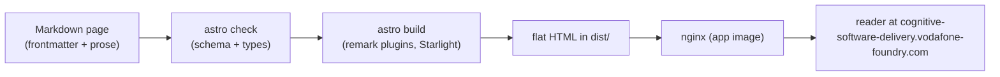

The app is a static documentation site: Markdown content compiled by Astro +
Starlight into flat HTML, served by nginx. This is the part-by-part map; what
the app publishes is [the overview](../../).

## Parts

| Part | Lives in | Role |
|---|---|---|
| Methodology content | `src/content/docs/` (repo root) | The product: the CSD methodology pages, one Markdown file per page, frontmatter enforced by the content schema. |
| Content schema | `src/content.config.ts` | Zod schema for the required frontmatter (title, id, type, status, updated). |
| Remark plugin | `src/plugins/` | Internal doc-link resolution at build time; diagrams render client-side via astro-mermaid. |
| Intent tests | `src/test/` + `intent.yaml` (repo root) | vitest-intent meta-tests attesting frontmatter and page-structure claims over every content page. |
| App image | `devops/Dockerfile` | Two stages: Node builds the site to `dist/`, nginx serves it on port 80 with `devops/nginx.conf`. |
| Deployment docs | `docs/` | This Starlight site, built by `docs/Dockerfile` under the portal prefix. |
| Helm chart | `k8s/` | Deployment + Service + HTTPRoute for the app, plus the docs Deployment + Service behind the central portal. |
| CI caller | `.github/workflows/` | Thin callers of the shared `VFPT-VODAFONE-FOUNDRY/adf-ci` build and test workflows. |

## How content becomes a served page

The vitest-intent suite runs beside the build: every `INT-STARLIGHT-*` claim in
the root `intent.yaml` is attested by a meta-test over the content pages, so a
page violating the frontmatter or structure contract fails the suite rather
than shipping.

## Access control

The site is public content: no route is protected, and `k8s/values.yaml` sets
`auth.existingSecret: ""` (the documented no-gate escape). Everything the app
serves is the published methodology.

## Deployment

Packaged by `devops/Dockerfile`, deployed via the `k8s/` Helm chart, exposed at
`cognitive-software-delivery.vodafone-foundry.com`, and reconciled by ArgoCD from the `deploy` branch.
This docs site publishes to `docs.vodafone-foundry.com/apps/cognitive-software-delivery`.
