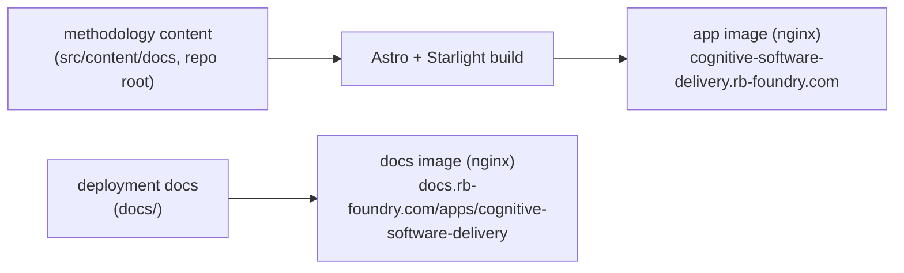

Cognitive Software Delivery (CSD) is a methodology for software delivery in the
AI era; this app publishes it. The product is the methodology site itself: the
content at the repository root builds to a static Starlight site served publicly
at [cognitive-software-delivery.rb-foundry.com](https://cognitive-software-delivery.rb-foundry.com). This docs site
describes the app as a deployable unit; the methodology content lives on the
site it documents.

## The two sites this repo ships

| Site | Source | Serves at |
|---|---|---|
| The methodology (the product) | repo root (`src/content/docs/`) | `cognitive-software-delivery.rb-foundry.com` |
| Deployment docs (this site) | `docs/` | `docs.rb-foundry.com/apps/cognitive-software-delivery` |

The content is public by design: the app carries no auth gate
(`k8s/values.yaml` sets `auth.existingSecret: ""`), so the hostname serves the
methodology to anyone.

## Read next

- [Components](architecture/components/): the part-by-part map of the build,
  the images, and the delivery path.
