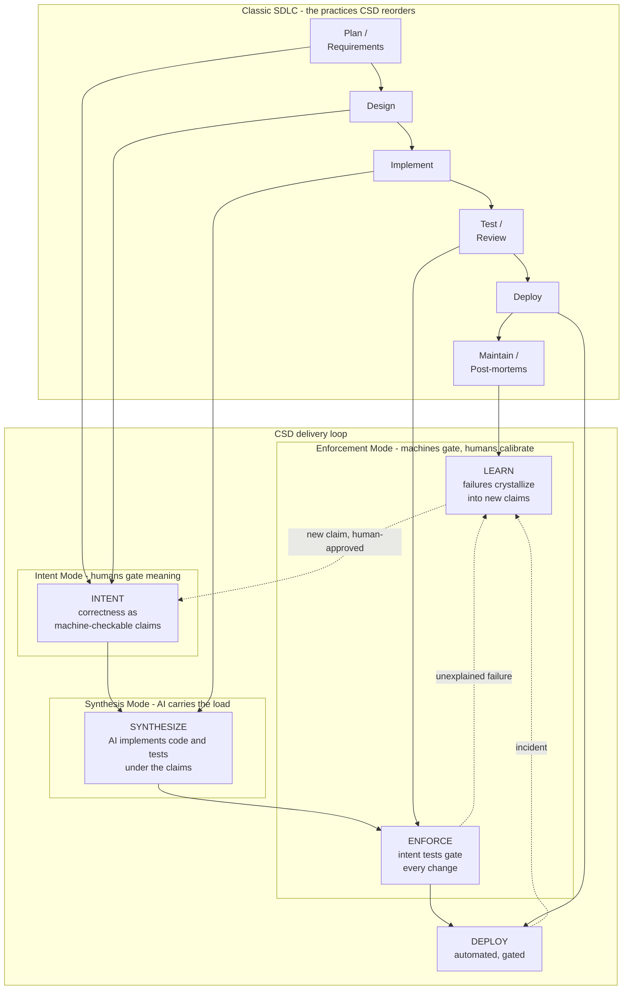
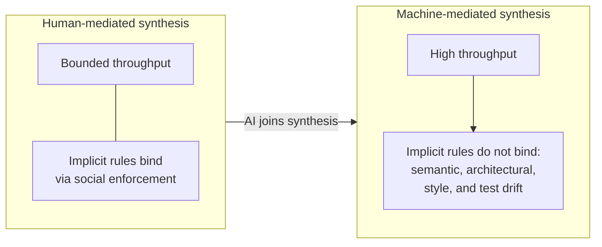
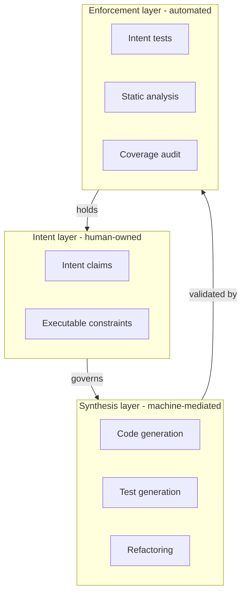

## Navigation

- **Children**:
  - [Intent Specification](./01-INTENT/00-OVERVIEW.md)
  - [Testing Strategy](./02-TESTING/00-OVERVIEW.md)
  - [Team Structures](./03-TEAMS/00-OVERVIEW.md)
  - [Delivery Lifecycle](./04-LIFECYCLE/00-OVERVIEW.md)
  - [Templates](./05-TEMPLATES/00-OVERVIEW.md)
  - [Adoption Guide](./06-ADOPTION/00-OVERVIEW.md)
  - [Contributing to CSD Docs](./07-CONTRIBUTING/00-OVERVIEW.md)

---

## 1. What CSD Is

Cognitive Software Delivery (CSD) is **not a new methodology**. It is glue: it reorders existing SDLC practice (requirements, design, code review, CI gates, post-mortems) into an AI-first delivery loop centered on **machine-checkable intent**, so AI can safely carry the synthesis load.

Every practice in CSD already exists. What CSD contributes is exactly two things:

- **An ordering.** Correctness criteria become machine-checkable claims *before* implementation starts, and every enforcement failure feeds back into the claim set.
- **A separation.** Judgment (deciding what must be true) and synthesis (making it so) are held apart, so machines can synthesize at machine throughput while humans keep the judgment.

Nothing in CSD invents process for its own sake: a practice belongs in the loop only if it helps a machine synthesize safely or a human gate meaningfully.

---

## 2. CSD in the SDLC

The diagram maps the classic SDLC onto the CSD delivery loop. Every classic phase survives; what changes is *when* it produces a machine-checkable artifact, *who* carries the work (AI or human), and *where* the gates sit.



Reading the map, practice by practice:

| Classic SDLC practice | CSD phase | Who does the work | Who gates |
|-----------------------|-----------|-------------------|-----------|
| Plan, requirements, design decisions | **Intent** | AI may draft claims | Human approves every claim (Intent Mode) |
| Implementation | **Synthesize** | AI generates code and tests | Human reviews at calibrated depth (Synthesis Mode) |
| Testing, code review, CI gates | **Enforce** | Machines run intent tests on every change | The gate is automated; no one can waive it |
| Post-mortems, lessons learned | **Learn** | AI drafts emergent claims from failures | Human approves crystallization (Intent Mode) |
| Release management | **Deploy** | Automated pipeline | Gated by Enforce |

The three **Cognitive Modes** (Intent, Synthesis, Enforcement) are the human hats across the loop, not job titles: one person can wear all three. See [Team Structures](./03-TEAMS/00-OVERVIEW.md).

---

## 3. Why the Reorder Is Needed

Traditional delivery governs synthesis with implicit, socially enforced rules: senior engineers hold the domain knowledge, architecture lives in conventions and diagrams, quality is a selective gate. That works while synthesis is human-mediated and bounded by human throughput.



When AI joins synthesis, the implicit governance fails to bind at the point of execution:

| Challenge | Traditional response | Why it fails with AI |
|-----------|----------------------|----------------------|
| Domain rules | Senior engineers hold knowledge | AI does not attend standup meetings |
| Architecture | Conventions and diagrams | Conventions do not participate in synthesis |
| Quality | Selective gates (code review) | Review becomes the bottleneck at AI throughput |
| Security | Periodic review, scanning | Cannot keep pace with generation rate |

This is not a tooling problem. It is a **delivery system problem**.

> The bottleneck has moved from implementation to cognition - from writing code to governing intent.

---

## 4. The CSD Response

CSD makes the constraints executable and the evidence binding, in three layers:



| Principle | Realized as |
|-----------|-------------|
| Constraints must be executable | Intent claims with test bindings |
| Evidence must be binding by default | Intent tests gate all changes |
| Judgment and synthesis must be separated | Cognitive Modes (Intent, Synthesis, Enforcement) |
| Intent must be explicit as durable artifacts | Versioned, machine-checkable claims in `intent.yaml` |

---

## 5. Core Concepts

### 5.1 Intent

**Intent** is a statement of truth that MUST hold for the system to be correct. A claim, in the canonical shape (normative in the [Intent Specification Standard](./01-INTENT/01-SPECIFICATION.md)):

```yaml
INT-001:
  version: 1.0.0
  status: active
  statement: "Session data must never cross user boundaries"
  test:
    scope: unit
    component: SessionService
    type: invariant
  criticality: critical
```

Intent is:

- Human-authored or human-approved (AI may draft, humans own meaning)
- Machine-checkable (every claim has a test binding)
- Technology-agnostic (stable across implementations)
- Versioned (changes require review)

Intent has two origins:

- **Authored Intent**: specified upfront before synthesis begins
- **Emergent Intent**: discovered from synthesis failures, crystallized into durable constraints

See: [Intent Specification](./01-INTENT/00-OVERVIEW.md) | [Emergent Intent](./01-INTENT/04-EMERGENT-INTENT.md)

### 5.2 Intent Tests

**Intent Tests** are the executable form of intent. A test attests a claim by carrying its `intent` marker:

```typescript
intent('INT-001', 'session data never crosses user boundaries', () => {
    /* test implementation */
});
```

Every active claim is attested by at least one test, or, at `llm` scope, by a reviewer's recorded verdict; one test may attest several claims. See [Testing Strategy](./02-TESTING/00-OVERVIEW.md).

### 5.3 Synthesis Governance

Machine-mediated synthesis is governed by constraints that participate in execution, not by documentation:

1. **Intent constraints** that the AI must satisfy
2. **Test gates** that block non-compliant changes
3. **Architectural boundaries** expressed as executable rules

### 5.4 Time to Trusted Output (TtTO)

**TtTO** is the elapsed time from when an AI produces an artifact to when that artifact is trusted enough to progress in the delivery pipeline.

```text
TtTO = T_generation + T_validation + T_review + T_correction
```

T_generation is near-zero. The metric is dominated by validation, review, and correction. CSD's purpose is to minimize TtTO through executable constraints, emergent intent capture, and trust calibration.

### 5.5 Trust Calibration

Not all AI output needs the same scrutiny. **Trust Calibration** assigns validation levels per artifact type, based on constraint maturity and risk:

| Trust level | Automated basis | Human review |
|-------------|-----------------|--------------|
| Level 0 | None | Everything |
| Level 1 | Structural (syntax, types) | Logic and meaning |
| Level 2 | Behavioral (tests + linting) | Architecture only |
| Level 3 | Autonomous (full constraints) | Periodic spot-check |

See: [Trust Calibration](./02-TESTING/05-TRUST-CALIBRATION.md)

### 5.6 Cognitive Modes

CSD defines three **Cognitive Modes** - not fixed job titles, but hats an individual wears depending on the task:

| Mode | Focus | Activity |
|------|-------|----------|
| **Intent Mode** | WHAT must be true | Specifying and approving intent |
| **Synthesis Mode** | HOW to implement | Guiding AI, reviewing output |
| **Enforcement Mode** | Does it HOLD? | Maintaining tests and constraints |

A single practitioner can operate in all three modes; larger teams may specialize. See [Team Structures](./03-TEAMS/00-OVERVIEW.md).

---

## 6. Methodology Summary

| Aspect | CSD approach |
|--------|--------------|
| **Who defines intent?** | Anyone in Intent Mode (humans own meaning) |
| **Who synthesizes code?** | Anyone in Synthesis Mode (humans + AI) |
| **Who enforces correctness?** | Automated tests + anyone in Enforcement Mode |
| **What gates changes?** | Intent tests must pass |
| **How is architecture preserved?** | Executable architectural constraints + drift detection |
| **How is quality maintained?** | Binding controls at synthesis time |
| **How is trust measured?** | Time to Trusted Output (TtTO) |
| **How does governance improve?** | Emergent Intent captures failures as permanent constraints |

---

## 7. Quick Navigation

| Topic | Document |
|-------|----------|
| How to write intent claims | [Intent Specification](./01-INTENT/00-OVERVIEW.md) |
| How to test intent | [Testing Strategy](./02-TESTING/00-OVERVIEW.md) |
| Cognitive Modes and teams | [Team Structures](./03-TEAMS/00-OVERVIEW.md) |
| End-to-end workflow | [Delivery Lifecycle](./04-LIFECYCLE/00-OVERVIEW.md) |
| Starting templates | [Templates](./05-TEMPLATES/00-OVERVIEW.md) |
| Migrating existing teams | [Adoption Guide](./06-ADOPTION/00-OVERVIEW.md) |

---

## Appendix

### A. Glossary

| Term | Definition |
|------|------------|
| **CSD** | Cognitive Software Delivery - existing SDLC practice reordered into an AI-first delivery loop centered on machine-checkable intent |
| **Intent** | Human-authored or human-approved statement of truth that must hold for system correctness |
| **Authored Intent** | Intent specified upfront before synthesis begins |
| **Emergent Intent** | Intent discovered from synthesis failures and crystallized into executable constraints |
| **Intent Test** | Executable validation bound to a specific intent |
| **Cognitive Mode** | A hat an individual wears: Intent, Synthesis, or Enforcement |
| **Intent Mode** | Cognitive mode focused on defining and approving what must be true |
| **Synthesis Mode** | Cognitive mode focused on guiding AI-assisted implementation |
| **Enforcement Mode** | Cognitive mode focused on maintaining tests and quality gates |
| **TtTO** | Time to Trusted Output - elapsed time from AI generation to trusted artifact |
| **Trust Calibration** | Practice of assigning appropriate validation levels per artifact type |
| **Trust Ratchet** | The effect of emergent intent: each captured failure permanently improves trust |
| **Invariant** | Condition that must always be true regardless of system state |
| **Test Scope** | Level at which a test executes: unit, integration, or e2e |

### B. References

- [When Machines Write Code](https://medium.com/@chaos.architect25/when-machines-write-code-b7d2452fc0e3) - The problem statement
- [Clean Architecture](https://blog.cleancoder.com/uncle-bob/2012/08/13/the-clean-architecture.html) - Architectural principles
- [TDD by Example](https://www.amazon.com/Test-Driven-Development-Kent-Beck/dp/0321146530) - Testing fundamentals

---

## Change Log

| Version | Date | Author | Changes |
|---------|------|--------|---------|
| 1.1.0 | 2026-07-04 | CSD Team | Glue positioning up front; CSD-in-the-SDLC map; diagrams in Mermaid |
| 1.0.0 | 2026-07-04 | CSD Team | Canonical claim shape and marker examples; promoted to Active |
| 0.1.0 | 2026-02-04 | CSD Team | Initial methodology draft |
