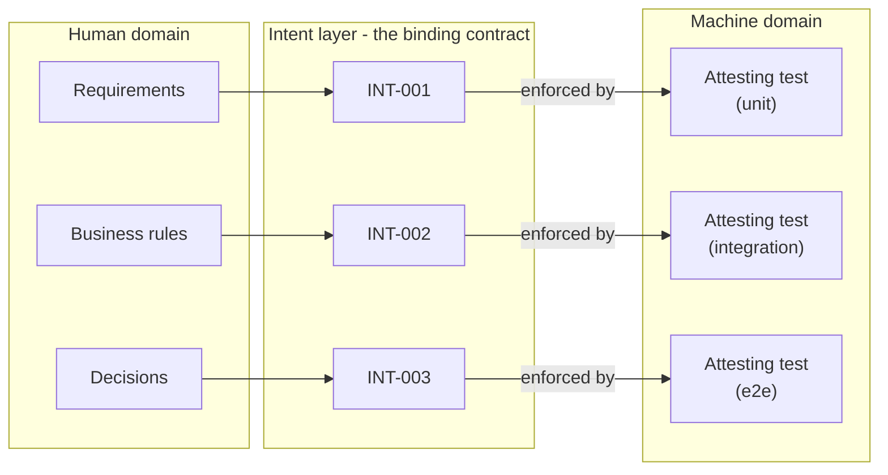

## Navigation

- **Parent**: [CSD Overview](../00-OVERVIEW.md)
- **Children**:
  - [Intent Specification Standard](./01-SPECIFICATION.md)
  - [Writing Effective Intent](./02-WRITING-INTENT.md)
  - [Intent Lifecycle](./03-LIFECYCLE.md)
  - [Emergent Intent](./04-EMERGENT-INTENT.md)
  - [Example Intents](./intents/00-INDEX.md)

---

## 1. Introduction

The **Intent Specification** is the authoritative source of truth for system correctness in Cognitive Software Delivery.

Intent represents what MUST be true for the system to be correct. It is:

- **Human-owned** - humans are the final authority on meaning
- **Machine-checkable** - every intent has an executable test
- **Technology-agnostic** - stable across implementations
- **Versioned** - changes require explicit review

Intent has two origins:

- **Authored Intent** - specified upfront by humans before synthesis
- **Emergent Intent** - discovered from synthesis failures, crystallized into constraints

AI may draft, suggest, and refine intent - but a human must approve every intent change. The dialogue between human and AI accelerates intent creation while preserving human ownership of meaning.

---

## 2. Why Intent Matters

### 2.1 The Problem with Implicit Rules

In traditional delivery, correctness criteria exist as:

- Knowledge in senior engineers' heads
- Comments in code
- Architectural diagrams
- Meeting notes and decisions

When AI generates code, it cannot access this implicit knowledge. The result is **semantic drift** - code that satisfies the immediate request but violates unstated rules.

### 2.2 The Solution: Explicit Intent

Intent makes correctness criteria **explicit and executable**:

```yaml
INT-001:
  version: 1.0.0
  status: active
  statement: "Session data must never cross user boundaries"
  test:
    scope: unit
    component: SessionService
    type: invariant
  criticality: critical
```

This intent:

- States exactly what must be true
- Specifies where to test it (unit scope, SessionService)
- Classifies its importance (critical)
- Has an associated test that gates all changes

---

## 3. Intent vs. Other Artifacts

| Artifact | Purpose | Who Owns | Machine-Checkable |
|----------|---------|----------|-------------------|
| **Requirements** | What to build | Product | [NO] Usually not |
| **User Stories** | Why we build it | Product | [NO] No |
| **Architecture** | How it fits together | Architecture | [WARN] Partially |
| **Intent** | What must be true | Intent Mode practitioner | [OK] Always |
| **Tests** | Verify correctness | Engineering | [OK] Yes |

Intent bridges the gap between human-readable requirements and machine-enforceable tests.



---

## 4. Core Concepts

### 4.1 What is Intent?

**Intent** is a statement of truth that MUST hold for the system to be correct.

Good intent statements:

- Are precise and unambiguous
- Use "must", "must not", "may" (RFC 2119 language)
- Can be verified by a test
- Are stable (don't change frequently)

### 4.2 Intent Components

Every intent specification includes:

| Component | Required | Description |
|-----------|----------|-------------|
| **ID** | [OK] | Unique identifier, the claim's YAML key (e.g., `INT-001`) |
| **Statement** | [OK] | The truth that must hold |
| **Test Binding** | [OK] | Scope, component, and type of the attesting test |
| **Criticality** | [OK] | Business importance (critical/high/medium/low) |
| **Rationale** | [WARN] | Why this intent exists |
| **Examples** | [WARN] | Concrete examples of pass/fail |

Test types (invariant, behavior, contract) and test scopes (unit, integration, e2e, llm) are defined in the [Intent Specification Standard](./01-SPECIFICATION.md); the [Testing Strategy](../02-TESTING/00-OVERVIEW.md) section covers how to choose them.

> **Principle**: Test intent at the smallest scope that can verify it. Unit is always preferable.

---

## 5. Intent Specification Format

The full schema, field rules, and file format are normative in the [Intent Specification Standard](./01-SPECIFICATION.md). A complete claim in `intent.yaml`:

```yaml
INT-001:
  version: 1.0.0
  status: active
  statement: "Session data must never cross user boundaries"
  test:
    scope: unit
    component: SessionService
    type: invariant
  criticality: critical
  domain: security
  rationale: |
    Session isolation is fundamental to multi-tenant security.
    Violation would expose user data across tenant boundaries.
  examples:
    pass:
      - "User A's session returns only User A's data"
    fail:
      - "User A's session returns User B's data"
  derived_from:
    - "SEC-REQ-001: Multi-tenant data isolation"
```

---

## 6. Quick Reference

| Question | Answer |
|----------|--------|
| Who writes intent? | Humans author, or AI drafts for human approval |
| Can AI write intent? | AI can draft/suggest; humans must approve every change |
| Can intent change? | Yes, with version bump and review |
| What if intent is wrong? | Fix the intent, not the test |
| Where does new intent come from? | Upfront specification OR emergent from synthesis failures |
| How many intents per system? | As many as needed, but prefer fewer precise intents |

---

## 7. Getting Started

1. Read [Intent Specification Standard](./01-SPECIFICATION.md)
2. Learn [Writing Effective Intent](./02-WRITING-INTENT.md)
3. Understand [Emergent Intent](./04-EMERGENT-INTENT.md)
4. Review [Example Intents](./intents/00-INDEX.md)
5. Create your first intent using the [Intent Template](../05-TEMPLATES/01-INTENT-SPEC-TEMPLATE.md)

---

## Change Log

| Version | Date | Author | Changes |
|---------|------|--------|---------|
| 1.1.0 | 2026-07-04 | CSD Team | Intent bridge diagram in Mermaid |
| 1.0.0 | 2026-07-04 | CSD Team | Canonical claim shape; schema detail deferred to the standard; promoted to Active |
| 0.1.0 | 2026-02-04 | CSD Team | Initial intent overview |
