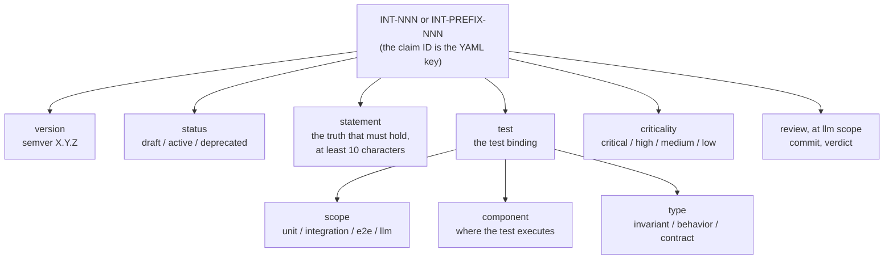
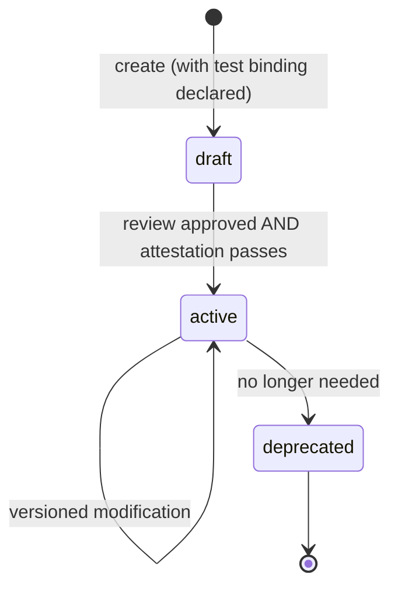

## Navigation

- **Parent**: [Intent Overview](./00-OVERVIEW.md)

---

## 1. Overview

This standard defines the structure, requirements, and rules for Intent Specifications in Cognitive Software Delivery. Validators and test runtimes implement this standard: a project conforms when its claims pass schema validation and every active claim has a passing test attestation or a current reviewer PASS at llm scope (Sections 3.5 and 7).

---

## 2. Intent Specification Schema

### 2.1 Claim Anatomy

A claim is one entry in the project's `intent.yaml` (Section 6). The claim ID is the YAML key, not a field:



Every claim MUST provide:

```yaml
INT-NNN:                  # the claim ID is the YAML key (see 3.1)
  version: X.Y.Z          # semantic version of the claim
  status: active          # draft | active | deprecated
  statement: "..."        # the truth that must hold (see 3.2)
  test:
    scope: unit           # unit | integration | e2e | llm
    component: "..."      # where the test executes
    type: invariant       # invariant | behavior | contract
  criticality: high       # critical | high | medium | low
```

### 2.2 Optional Fields

Validators enforce the required shape and a present `review` block (Section 4). Other additional keys on a claim are annotations: permitted, ignored by validators, and meaningful to humans and tooling that read the file. The recommended vocabulary:

```yaml
  rationale: "..."        # why this claim exists (recommended)
  domain: security        # logical domain
  origin: emergent        # provenance of a crystallized claim (see Emergent Intent)
  examples:
    pass:
      - "Scenario that satisfies the claim"
    fail:
      - "Scenario that violates the claim"
  derived_from:
    - "Requirement or decision ID"
  related:
    - INT-XXX             # related claims
```

### 2.3 Legacy Flat Form

A top-level `scope` field in place of the nested `test.scope` is accepted by validators with a warning, so existing projects can migrate claim by claim. New claims MUST use the nested `test` block.

---

## 3. Field Specifications

### 3.1 ID

| Rule | Specification |
|------|---------------|
| Canonical form | `INT-NNN` (three-digit zero-padded), for single-module projects |
| Extended form | `INT-PREFIX-NNN` (uppercase prefix), for monorepos and reusable claim bundles |
| Validation pattern | `^INT-[A-Z0-9-]+$` |
| Uniqueness | Globally unique within the project |
| Immutability | MUST NOT change after creation |
| Reuse | Deprecated IDs MUST NOT be reused |

The prefix in the extended form names the module or bundle the claim governs, so claims from several sources can coexist in one `intent.yaml` without colliding.

### 3.2 Statement

The statement is the core of the intent. It MUST:

| Requirement | Example |
|-------------|---------|
| Be a single sentence | [OK] "Sessions must be isolated per user" |
| Be at least 10 characters | Schema-enforced minimum |
| Use RFC 2119 language | [OK] "must", "must not", "should", "may" |
| Be testable | [OK] Can write a test that passes or fails |
| Be technology-agnostic | [OK] No mention of specific frameworks |

**RFC 2119 Keywords**:

- **MUST** / **MUST NOT**: Absolute requirement
- **SHOULD** / **SHOULD NOT**: Strong recommendation
- **MAY**: Optional

### 3.3 Test Binding

Every intent MUST specify how it will be tested:

#### Scope

| Scope | Characteristics | Prefer When |
|-------|-----------------|-------------|
| `unit` | Fast, isolated, no external deps | Default choice |
| `integration` | Cross-component, may use test doubles | Component interactions |
| `e2e` | Full system, real dependencies | User-visible workflows |
| `llm` | Judged by a reviewer, not executed by a runner | The claim is true or false about *meaning*, and no runner can decide it |

> **Rule**: Use the smallest scope that can verify the intent. Unit is always preferable. The rule orders `unit`, `integration` and `e2e`; `llm` is not on that ladder and is chosen by a different question, below.

**`llm` is the scope for a claim a test cannot decide.** Some claims are propositions about
language or judgement rather than about observable state: whether a statement is falsifiable,
whether an error message explains the failure, whether a document says what it claims to say. A
runner cannot answer those, and writing a mechanical test that approximates the answer produces a
green that means nothing. Such a claim binds at `llm` scope and is attested by a **reviewer's
recorded verdict** rather than by a test run.

The judgement is the claim's latest **`review` block in `intent.yaml`** (Section 3.5). A fresh reviewer reads the claim's subject at a full Git commit id and supplies a PASS or FAIL. The caller records only that verdict and commit in the project's repository; the reviewer's record holds the reasoning. Git history holds earlier records.

A reviewer judges the claims whose subjects it reads. CI validates the recorded judgement and its freshness; it makes no model call. An active `llm` claim needs a current PASS. Draft and deprecated claims may remain unreviewed.

#### Component

The component field specifies WHERE the test executes. **At `llm` scope nothing executes, so it names the claim's SUBJECT instead** - what the reviewer judges (a claim set, a document, a message catalogue). Illustrative forms:

```yaml
# Single component
component: SessionService

# Package/module
component: com.example.security

# Multiple components (integration)
component: [SessionService, UserRepository]
```

#### Type

| Type | Definition | Test Characteristic |
|------|------------|---------------------|
| `invariant` | Must ALWAYS be true | Property-based or exhaustive |
| `behavior` | Expected response to input | Given-When-Then |
| `contract` | Interface guarantee | Input/output validation |

### 3.4 Criticality

| Level | Definition | Failure Impact |
|-------|------------|----------------|
| `critical` | System cannot function | Immediate production incident |
| `high` | Major feature broken | User-impacting, urgent fix |
| `medium` | Degraded experience | Can wait for next release |
| `low` | Minor issue | Nice to fix |

---

### 3.5 Review

An `llm` claim MAY carry its latest review. A present review MUST contain exactly two fields:

```yaml
  review:
    commit: "<full-git-commit-id>" # lowercase 40- or 64-character hexadecimal id
    verdict: PASS                # PASS | FAIL
```

| Field | Requirement |
| --- | --- |
| `commit` | The full commit the reviewer read |
| `verdict` | `PASS` or `FAIL` |

A new judgement replaces this mapping. Git preserves previous judgements. The reviewer's PR or delivery record carries the reasoning and findings.

The reviewed commit MUST be readable. A judgement is **current** when repository content matches that commit. Specification comparisons exclude each claim's `review` and lifecycle `status`; recording reviews and activating claims therefore preserves freshness. Other content changes, including unrelated files, make a review **stale**. Working-tree reads include untracked files that Git does not ignore. An unavailable commit or unreadable specification is **unresolvable**. Neither state attests a claim.

The recording commit follows the reviewed commit: a file cannot contain the hash of the commit that contains that same file. A record has no wall-clock expiry.

---

## 4. Validation Rules

### 4.1 Schema Validation

Required on every claim: `version`, `status`, `statement`, `criticality`, and a scope (as `test.scope`, or top-level `scope` in the legacy flat form, in which case the `test` block may be absent). When the `test` block is present, `test.component` and `test.type` are required. In JSON Schema style:

```yaml
# Validation schema for one claim (the ID is the enclosing YAML key)
type: object
required:
  - version
  - status
  - statement
  - criticality
  - test
properties:
  version:
    type: string
    pattern: "^[0-9]+\\.[0-9]+\\.[0-9]+$"
  status:
    enum: [draft, active, deprecated]
  statement:
    type: string
    minLength: 10
  test:
    type: object
    required: [scope, component, type]
    properties:
      scope:
        enum: [unit, integration, e2e, llm]
      type:
        enum: [invariant, behavior, contract]
  criticality:
    enum: [critical, high, medium, low]
```

Claim IDs (the YAML keys) MUST match `^INT-[A-Z0-9-]+$`. A present `review` block is validated against Section 3.5 and is permitted only at `llm` scope. Other additional keys are annotations (Section 2.2).

### 4.2 Semantic Validation

| Rule | Check |
|------|-------|
| Statement must be testable | Contains verifiable condition |
| Scope must match complexity | Unit for simple, integration for cross-component |
| Component must exist | References valid system component |
| No duplicate IDs | ID is unique across all intents |

---

## 5. Lifecycle Rules

### 5.1 States



Review is a process transition, not a stored status: a claim under review remains `draft` until approved.

### 5.2 Creation

1. Intent MUST start as `status: draft`
2. Draft intents MUST declare their test binding (even if the test is not yet implemented)
3. Intent review MUST include approval from the practitioner in Intent Mode

### 5.3 Activation

1. Intent MUST have a passing attesting test before `status: active`, **or, at `llm` scope, a current `review.verdict: PASS`**
2. Active intents MUST be enforced in CI/CD; at `llm` scope the audit checks the recorded review and its freshness
3. Activation requires version `1.0.0`

### 5.4 Modification

| Change Type | Version Bump | Review Required |
|-------------|--------------|-----------------|
| Statement change | MAJOR | Full review |
| Scope change | MAJOR | Full review |
| Component change | MINOR | Intent Mode practitioner |
| Rationale update | PATCH | No |
| Example addition | PATCH | No |

At `llm` scope, every change to a field participating in Section 3.5's comparison requires a fresh judgement before the claim is attested again.

### 5.5 Deprecation

1. Set `status: deprecated`
2. Add `deprecated_reason` field
3. Keep for historical reference
4. ID remains reserved forever

---

## 6. File Format

Claims live in a single `intent.yaml` at the project root. Claim IDs are the top-level keys; keys that do not start with `INT-` are ignored, so the file can carry commentary or tooling metadata.

```yaml
# intent.yaml
INT-001:
  version: 1.0.0
  status: active
  statement: "Session data must never cross user boundaries"
  test:
    scope: unit
    component: SessionService
    type: invariant
  criticality: critical

INT-002:
  version: 1.0.0
  status: active
  statement: "Passwords must be hashed using an adaptive algorithm"
  test:
    scope: unit
    component: PasswordService
    type: invariant
  criticality: critical
```

A claim MAY additionally be documented as a page (rationale, examples, traceability), as this site does for its own claims. `intent.yaml` remains the machine-read source that validators run against; pages annotate it.

---

## 7. Test Binding Markers

A claim is bound to executable tests by a marker in the test itself. The marker contract is runtime-agnostic:

| Rule | Specification |
|------|---------------|
| Declaration | A test declares the claim ID(s) it attests via an `intent` marker |
| Multiplicity | One test MAY attest several claims; every active claim MUST be attested by at least one test, **except a claim at `llm` scope**, which is attested by a current review PASS under Section 3.5 and carries no marker |
| Audit | A standalone auditor validates schema (this standard), orphans (markers referencing unknown claims), and coverage (active claims with no test attestation or current review PASS) |

Illustrative marker shapes:

```python
# Python test runner: the @intent decorator
@intent("INT-001")
def test_session_data_never_crosses_user_boundaries():
    ...
```

```typescript
// JS/TS test runners: the intent() wrapper around test()
intent('INT-001', 'session data never crosses user boundaries', () => {
    /* ... */
});
```

See [Testing Strategy](../02-TESTING/00-OVERVIEW.md) for the testing model and [Intent Test Implementation](../02-TESTING/03-IMPLEMENTATION.md) for the runtime bindings.

---

## Change Log

| Version | Date | Author | Changes |
|---------|------|--------|---------|
| 1.1.0 | 2026-07-04 | CSD Team | Claim anatomy and lifecycle states as diagrams; optional fields stated as validator-ignored annotations |
| 1.0.0 | 2026-07-04 | CSD Team | Aligned with the validator implementation: extended ID form, ID as YAML key, single intent.yaml file format, marker contract; promoted to Active |
| 0.1.0 | 2026-02-04 | CSD Team | Initial specification standard |
