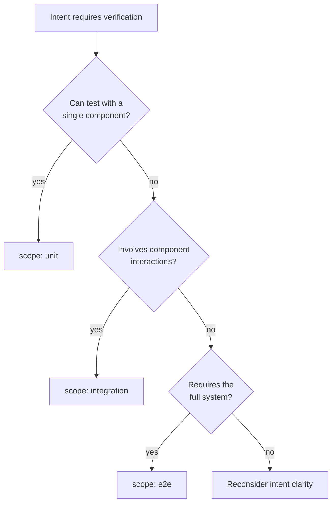

## Navigation

- **Parent**: [Intent Overview](./00-OVERVIEW.md)

---

## 1. Overview

This guide provides practical advice for writing effective intent specifications. Good intent is precise, testable, and stable.

---

## 2. The Intent Statement Formula

### 2.1 Basic Structure

```text
{Subject} {must/must not/should/may} {condition}
```

**Examples**:

- "Passwords **must not** be stored in plaintext"
- "API responses **must** include a correlation ID"
- "Cache entries **should** expire within 24 hours"
- "Users **may** have multiple active sessions"

### 2.2 Stronger Patterns

For invariants (things that must ALWAYS be true):

```text
{Subject} {must never/must always} {condition} [regardless of {context}]
```

**Examples**:

- "Session data **must never** cross user boundaries"
- "Audit logs **must always** capture user identity"
- "Sensitive fields **must never** appear in logs, regardless of log level"

---

## 3. Good vs. Bad Intent

### 3.1 Precision

[NO] **Vague**:

```yaml
statement: "The system should be secure"
```

[OK] **Precise**:

```yaml
statement: "Authentication tokens must expire within 24 hours of issuance"
```

### 3.2 Testability

[NO] **Untestable**:

```yaml
statement: "The user experience should be good"
```

[OK] **Testable**:

```yaml
statement: "Search results must return within 200ms for queries under 100 characters"
```

### 3.3 Technology-Agnostic

[NO] **Technology-specific**:

```yaml
statement: "Spring Security must validate JWT tokens"
```

[OK] **Technology-agnostic**:

```yaml
statement: "Authentication tokens must be validated before accessing protected resources"
```

### 3.4 Stability

[NO] **Volatile** (changes with implementation):

```yaml
statement: "The UserService.authenticate() method must return a UserDTO"
```

[OK] **Stable** (survives refactoring):

```yaml
statement: "Successful authentication must return user identity and permissions"
```

---

## 4. Deriving Intent

### 4.1 From Requirements

```text
Requirement: "Users can only see their own orders"

Intent:
  statement: "Order queries must filter by authenticated user ID"
  test: { scope: unit, component: OrderRepository, type: invariant }
```

### 4.2 From Security Reviews

```text
Security Finding: "Potential SQL injection in search"

Intent:
  statement: "Database queries must use parameterized statements"
  test: { scope: unit, component: DataAccessLayer, type: invariant }
```

### 4.3 From Architectural Decisions

```text
Decision: "Use event sourcing for audit trail"

Intent:
  statement: "State changes must emit domain events before persistence"
  test: { scope: integration, component: AggregateRoot, type: behavior }
```

### 4.4 From Production Incidents

```text
Incident: "Memory leak from unclosed connections"

Intent:
  statement: "Database connections must be closed within the request lifecycle"
  test: { scope: integration, component: ConnectionPool, type: invariant }
```

---

## 5. Choosing the Right Scope

### 5.1 Decision Tree



### 5.2 Scope Guidelines

| If the intent involves... | Use scope |
|---------------------------|-----------|
| Single class/function logic | `unit` |
| Input validation | `unit` |
| Data transformation | `unit` |
| Two components interacting | `integration` |
| Database operations | `integration` |
| External service calls | `integration` |
| User workflows | `e2e` |
| Cross-service behavior | `e2e` |

### 5.3 The "Push Down" Principle

Always try to push intent to a smaller scope:

```yaml
# Can this e2e intent be verified at integration level?
# e2e:
statement: "Users can complete checkout"

# Better: Break into smaller intents
# integration:
statement: "Cart total must equal sum of item prices"
statement: "Payment processing must validate card before charging"

# unit:
statement: "Order must contain at least one item"
```

---

## 6. Choosing the Right Type

| Type | Use When | Test Style |
|------|----------|------------|
| `invariant` | Must ALWAYS be true, regardless of input | Property-based, exhaustive |
| `behavior` | System responds to specific inputs | Given-When-Then |
| `contract` | Interface guarantees to callers | Input/output specs |

### 6.1 Invariant Examples

```yaml
- statement: "Account balance must never be negative"
  type: invariant

- statement: "Passwords must never appear in logs"
  type: invariant

- statement: "Session tokens must be cryptographically random"
  type: invariant
```

### 6.2 Behavior Examples

```yaml
- statement: "Submitting valid login credentials must return a session token"
  type: behavior

- statement: "Deleting a user must cascade to their orders"
  type: behavior

- statement: "Exceeding rate limit must return HTTP 429"
  type: behavior
```

### 6.3 Contract Examples

```yaml
- statement: "API must return 400 for malformed JSON"
  type: contract

- statement: "Pagination must support limit and offset parameters"
  type: contract

- statement: "Error responses must include error code and message"
  type: contract
```

---

## 7. Common Mistakes

### 7.1 Intent Too Broad

[NO] **Too broad**:

```yaml
statement: "The payment system must work correctly"
```

[OK] **Specific**:

```yaml
statement: "Payment charges must be idempotent for duplicate request IDs"
```

### 7.2 Multiple Concerns in One Intent

[NO] **Multiple concerns**:

```yaml
statement: "Users must be authenticated and their actions must be logged"
```

[OK] **Separated**:

```yaml
# INT-001
statement: "Protected endpoints must require authentication"

# INT-002  
statement: "User actions must be recorded in audit log"
```

### 7.3 Implementation Details

[NO] **Implementation detail**:

```yaml
statement: "Redis cache must have 1-hour TTL"
```

[OK] **Intent-focused**:

```yaml
statement: "Cached data must not be stale beyond 1 hour"
```

### 7.4 Testing the Test

[NO] **Circular**:

```yaml
statement: "The unit test must pass"
```

[OK] **Meaningful**:

```yaml
statement: "Division by zero must throw ArithmeticException"
```

---

## 8. Intent Review Checklist

Before submitting an intent specification:

- [ ] Statement uses RFC 2119 language (must/should/may)
- [ ] Statement is a single, clear sentence
- [ ] Statement is technology-agnostic
- [ ] Statement is testable (can write pass/fail test)
- [ ] Scope is the smallest that can verify the intent
- [ ] Component exists and is correct
- [ ] Type (invariant/behavior/contract) is appropriate
- [ ] Criticality reflects business impact
- [ ] No duplicate or overlapping intents exist

---

## Change Log

| Version | Date | Author | Changes |
|---------|------|--------|---------|
| 1.1.0 | 2026-07-04 | CSD Team | Scope decision tree in Mermaid |
| 1.0.0 | 2026-07-04 | CSD Team | Derivation examples use the canonical test binding; promoted to Active |
| 0.1.0 | 2026-02-04 | CSD Team | Initial writing guide |
