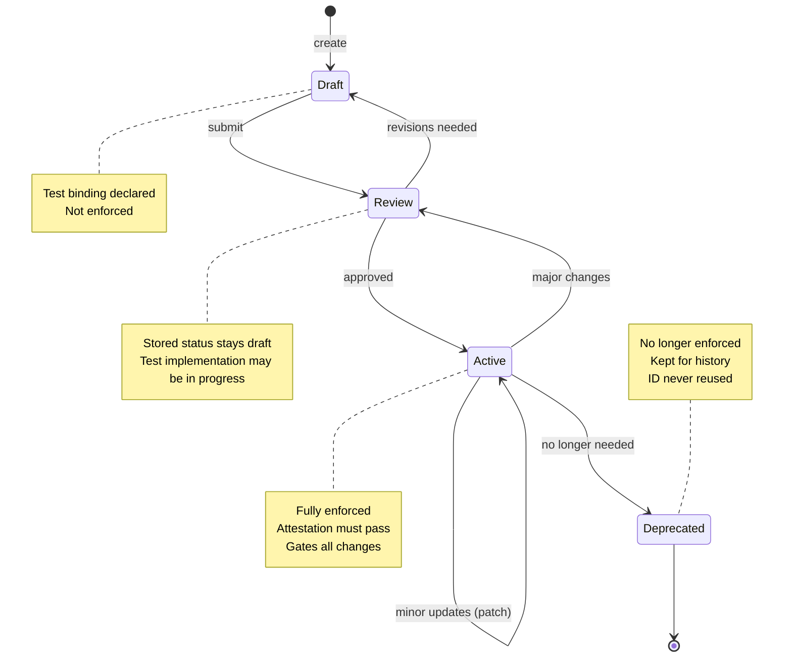

## Navigation

- **Parent**: [Intent Overview](./00-OVERVIEW.md)

---

## 1. Overview

Intent specifications follow a defined lifecycle from creation to deprecation. This guide describes each phase and the rules that govern transitions.

---

## 2. Lifecycle States



| State | Stored `status` | Enforcement | Test Required | Changes Allowed |
|-------|-----------------|-------------|---------------|-----------------|
| Draft | `draft` | None | Spec only | Any |
| Review | `draft` (review is a transition, not a status value) | None | Implementation in progress | Any |
| Active | `active` | Full | Passing test or current `llm` PASS review | Versioned only |
| Deprecated | `deprecated` | None | N/A | None |

---

## 3. Phase Details

### 3.1 Draft Phase

**Entry**: Intent is created

**Requirements**:

- Intent specification file exists
- All required fields populated
- Test specification defined (not necessarily implemented)

**Allowed Activities**:

- Modify any field
- Delete intent entirely
- Request review

**Exit**: Submit for review

```yaml
# Draft intent
id: INT-042
version: 0.1.0
status: draft
statement: "API rate limiting must enforce 100 requests per minute per user"
test:
  scope: integration
  component: RateLimiter
  type: behavior
criticality: medium
```

### 3.2 Review Phase

**Entry**: Intent submitted for review

**Requirements**:

- Intent spec is complete
- Test implementation in progress or complete
- Intent Mode practitioner assigned

**Review Checklist**:

- [ ] Statement is clear and testable
- [ ] Scope is appropriate (smallest possible)
- [ ] Component is correct
- [ ] Type is appropriate
- [ ] Criticality reflects business impact
- [ ] No conflicts with existing intents
- [ ] Test validates the actual statement

**Exit**: Approved  ->  Active, or Revisions  ->  Draft

### 3.3 Active Phase

**Entry**: Review approved, tests passing

**Requirements**:

- Version must be `1.0.0` or higher
- All tests must pass
- Enforced in CI/CD pipeline

**Allowed Changes**:

| Change | Version Bump | Approval |
|--------|--------------|----------|
| Typo fix in rationale | PATCH | None |
| Add example | PATCH | None |
| Clarify statement (same meaning) | PATCH | Intent Mode practitioner |
| Change component | MINOR | Intent Mode practitioner |
| Add test scope | MINOR | Intent Mode practitioner |
| Change statement meaning | MAJOR | Full review |
| Change scope down | MAJOR | Full review |
| Change criticality up | MINOR | Intent Mode practitioner |
| Change criticality down | MAJOR | Full review |

**Exit**: Deprecate

### 3.4 Deprecated Phase

**Entry**: Intent no longer needed

**Requirements**:

- `deprecated_reason` field added
- `deprecated_date` field added
- Replacement intent linked (if applicable)

**Rules**:

- ID is NEVER reused
- File is kept for historical reference
- Tests may be removed from CI/CD

```yaml
id: INT-007
version: 1.2.0
status: deprecated
deprecated_reason: "Replaced by INT-042 with improved rate limiting model"
deprecated_date: 2026-02-04
replaced_by: INT-042
statement: "API requests must be throttled to 50 per minute"
# ... rest of spec
```

---

## 4. Version Management

### 4.1 Versioning Rules

| Version | Meaning |
|---------|---------|
| `0.x.x` | Draft, not yet active |
| `1.0.0` | First active version |
| `x.Y.0` | Backward-compatible additions |
| `x.y.Z` | Clarifications, typo fixes |
| `X.0.0` | Breaking changes to statement |

### 4.2 What Constitutes Breaking Change

**Breaking** (MAJOR bump):

- Changing the statement's meaning
- Reducing scope (e2e  ->  integration  ->  unit)
- Reducing criticality (critical  ->  high  ->  medium)
- Changing test type

**Non-breaking** (MINOR bump):

- Adding new test scope (unit also tested at integration)
- Expanding component coverage
- Increasing criticality

### 4.3 Version History

Intent specs SHOULD maintain a change log:

```yaml
changelog:
  - version: 1.1.0
    date: 2026-02-04
    author: Jane Doe
    changes: "Added integration test scope"
  - version: 1.0.0
    date: 2026-01-15
    author: John Smith
    changes: "Initial active version"
  - version: 0.1.0
    date: 2026-01-10
    author: John Smith
    changes: "Initial draft"
```

---

## 5. Ownership

### 5.1 Intent Mode Responsibilities

| Responsibility | Description |
|----------------|-------------|
| Author intent | Write clear, testable specifications |
| Review changes | Approve modifications to owned intents |
| Maintain accuracy | Update intent when requirements change |
| Deprecate | Remove intents that no longer apply |

### 5.2 Ownership Transfer

When the intent owner leaves or changes team:

1. Assign new intent owner
2. Update `owner` field in intent spec
3. New owner reviews and acknowledges

---

## 6. Conflict Resolution

### 6.1 Conflicting Intents

If two intents conflict:

1. Identify which has higher criticality
2. Determine if both can coexist with refinement
3. Deprecate one if true conflict
4. Document resolution

### 6.2 Intent vs. Implementation

If implementation cannot satisfy intent:

1. **Never** change intent to match implementation
2. Escalate to the Intent Mode practitioner
3. Either fix implementation OR
4. Formal review to modify intent

> **Principle**: Intent defines correctness. Implementation must conform.

---

## 7. Enforcement

Active claims are enforced continuously: schema validation and the attesting tests run as merge gates, and a coverage audit fails when an active claim has no attesting test (an `llm` claim carries a latest `review` block in `intent.yaml`; the audit requires a current PASS and validates claim and evidence freshness without a model call). See [Continuous Enforcement](../04-LIFECYCLE/03-CONTINUOUS-ENFORCEMENT.md) for the enforcement points and [Intent Test Implementation](../02-TESTING/03-IMPLEMENTATION.md) for the audit mechanism.

---

## Change Log

| Version | Date | Author | Changes |
|---------|------|--------|---------|
| 1.1.0 | 2026-07-04 | CSD Team | Lifecycle states in Mermaid |
| 1.0.0 | 2026-07-04 | CSD Team | Review clarified as a transition; enforcement stated as criteria, not pipeline config; promoted to Active |
| 0.1.0 | 2026-02-04 | CSD Team | Initial lifecycle guide |
