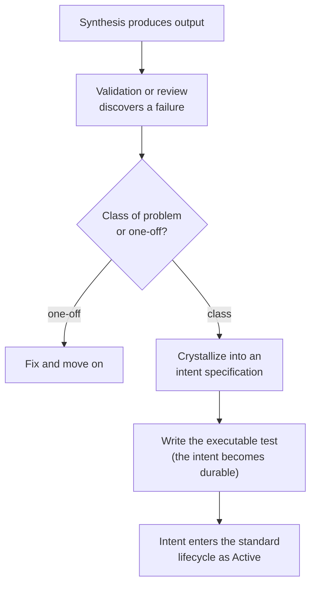
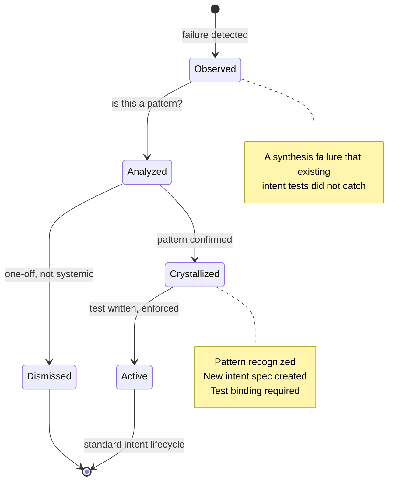

## Navigation

- **Parent**: [Intent Overview](./00-OVERVIEW.md)

---

## 1. Overview

Not all intent is known upfront. **Emergent Intent** is intent that crystallizes from observed synthesis failures into durable, executable constraints.

Traditional CSD assumes intent flows top-down: humans specify, machines implement, tests enforce. In practice, a significant portion of intent is **discovered** - not designed - through the failures that synthesis produces.

> **Principle**: Every failure that repeats is a missing intent. Every captured failure is a permanent constraint.

---

## 2. Why Emergent Intent Matters

### 2.1 The Certainty Illusion

Agile taught us that requirements are uncertain and evolve through iteration. CSD must apply the same lesson to intent itself:

- We cannot know all invariants before synthesis begins
- AI synthesis produces novel failure modes that humans didn't anticipate
- Domain rules that were "obvious" to senior engineers become visible only when AI violates them

Assuming perfect upfront intent repeats the Waterfall mistake at a different layer.

### 2.2 Case Study: A Generated-Docs Audit

In a documentation audit, 105+ fabricated code blocks were discovered - hallucinated service names, wrong API paths, invented SAP entity sets. No upfront intent specification anticipated "documentation must only reference services that actually exist." That intent **emerged** from the first observed hallucination.

The resulting test suite grew from 1 test to 108 tests, each one a crystallized emergent intent:

| Discovery | Emergent Intent | Executable Constraint |
|-----------|----------------|----------------------|
| Fabricated service name | "Docs must reference real services" | Service name validation test |
| Wrong API path | "API paths must match OpenAPI specs" | Path cross-reference test |
| Inconsistent terminology | "Terminology must follow glossary" | 16-rule terminology test |
| Broken cross-references | "All internal links must resolve" | Link integrity test |
| Invalid metadata | "All docs must have required metadata" | Metadata schema test |

---

## 3. The Emergent Intent Lifecycle

Unlike authored intent (which starts as a specification), emergent intent starts as a failure:



### 3.1 Lifecycle States



### 3.2 The Ratchet Effect

Emergent intent creates a **trust ratchet**: each failure class that gets converted into an executable test is a permanent improvement to TtTO. That class of failure can never recur undetected. Over time, the system becomes increasingly trustworthy - not because the AI improves, but because the constraints tighten.

```text
Week 1:  5 intent tests  -> TtTO: 20 min (lots of manual review)
Week 4:  30 intent tests -> TtTO: 5 min  (most issues caught automatically)
Week 12: 108 intent tests -> TtTO: 35 sec (trust is a system property)
```

---

## 4. Capturing Emergent Intent

### 4.1 Triggers

Emergent intent should be captured when:

- A synthesis failure is observed more than once
- A human reviewer catches an issue that "should have been obvious"
- A domain expert says "that should never happen"
- A post-incident review reveals an unwritten rule

### 4.2 Template

```yaml
INT-EMG-001:
  version: 1.0.0
  status: active
  statement: "Documentation must only reference services listed in the service registry"
  test:
    scope: unit
    component: docs
    type: invariant
  criticality: high
  rationale: |
    AI models hallucinate plausible-sounding service names that don't exist.
    Without this constraint, documentation becomes untrustworthy.

  # Emergent-specific fields (optional extensions)
  origin: emergent
  discovered_from: "AI-generated documentation contained fabricated service names"
  first_observed: 2026-03-15
  occurrence_count: 12
  crystallized: 2026-03-16
```

### 4.3 From Emergent to Authored

Once an emergent intent is active, it behaves identically to authored intent. The `origin: emergent` field preserves the provenance, but the enforcement is the same. Over time, emergent intents may be consolidated, refined, or promoted into broader authored intent categories.

---

## 5. Preventing Recurrence

The purpose of emergent intent is not just to catch failures - it is to **prevent them from recurring**. This connects directly to TtTO:

| Without Emergent Intent | With Emergent Intent |
|------------------------|---------------------|
| Same hallucination appears repeatedly | Caught on first occurrence after crystallization |
| Human reviewer must remember to check | Automated test enforces permanently |
| Knowledge lives in a person's head | Knowledge lives in an executable test |
| TtTO stays high (manual review) | TtTO ratchets down (automated trust) |

---

## 6. Relationship to Other CSD Concepts

- **Authored Intent**: Emergent intent supplements, not replaces, upfront specification. The two are complementary.
- **Intent Lifecycle**: Emergent intent enters the standard lifecycle at the Active state once crystallized.
- **TtTO**: Each emergent intent captured reduces TtTO permanently for that failure class.
- **Trust Calibration**: Emergent intent is the mechanism by which trust calibration improves over time.

---

## Change Log

| Version | Date | Author | Changes |
|---------|------|--------|---------|
| 1.1.0 | 2026-07-04 | CSD Team | Capture flow and lifecycle states in Mermaid |
| 1.0.0 | 2026-07-04 | CSD Team | Capture template in canonical claim shape; case study genericized; promoted to Active |
| 0.1.0 | 2026-04-17 | CSD Team | Initial emergent intent guide |
