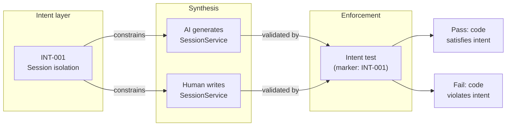

## Navigation

- **Parent**: [CSD Overview](../00-OVERVIEW.md)
- **Children**:
  - [Test Scopes](./01-TEST-SCOPES.md)
  - [Test Types](./02-TEST-TYPES.md)
  - [Intent Test Implementation](./03-IMPLEMENTATION.md)
  - [Test Organization](./04-ORGANIZATION.md)
  - [Trust Calibration](./05-TRUST-CALIBRATION.md)

---

## 1. Introduction

In Cognitive Software Delivery, tests are not just validation - they are the **enforcement mechanism** for intent. Tests make intent executable.

> **Core Principle**: Humans define meaning. Tests enforce it. Machines implement it.

---

## 2. The Role of Testing in CSD

### 2.1 Traditional Testing vs. Intent Testing

| Aspect | Traditional Testing | Intent Testing |
|--------|---------------------|----------------|
| **Purpose** | Verify implementation works | Enforce intent holds |
| **Derived from** | Implementation details | Intent specifications |
| **Changes when** | Code changes | Intent changes |
| **Ownership** | Developers | Intent Mode (define) + Developers (implement) |
| **Failure meaning** | "Code is broken" | "Intent is violated" |

### 2.2 Why Intent Tests Matter for AI

When AI generates code:

- It doesn't know your domain rules
- It can't attend your architecture meetings
- It synthesizes based on patterns, not meaning

**Intent tests are the binding constraint** that ensures AI-generated code satisfies human-defined correctness criteria.



---

## 3. Test Hierarchy

### 3.1 Test Scopes

Tests execute at different scopes based on what they verify:

| Scope | Speed | Isolation | Use For |
|-------|-------|-----------|---------|
| **Unit** | < 100ms | Complete | Single component logic, invariants |
| **Integration** | < 5s | Partial | Component interactions, contracts |
| **E2E** | < 60s | None | User workflows, system behavior |

> **Principle**: Test at the smallest scope possible. Unit is always preferable.

### 3.2 Test Types

Tests are classified by what they verify:

| Type | Verifies | Test Style |
|------|----------|------------|
| **Invariant** | Always true | Property-based, exhaustive |
| **Behavior** | Response to input | Given-When-Then |
| **Contract** | Interface guarantees | Input/output validation |

---

## 4. Intent Test Requirements

### 4.1 Every Intent MUST Have a Test

```yaml
# Intent without test = unenforceable intent
INT-001:
  statement: "Session data must never cross user boundaries"
  test:
    scope: unit
    component: SessionService
    type: invariant
```

### 4.2 Test MUST Reference Intent

```typescript
intent('INT-001', 'session data never crosses user boundaries', () => {
    /* ... */
});
```

### 4.3 Test MUST Gate Changes

Intent tests run on every change and **block merges** when they fail. Failing intent tests are never skipped, quarantined, or marked allowed-to-fail; the remedy is fixing the implementation or formally revising the intent.

---

## 5. The Test Pyramid for Intent

Intent tests follow the classic pyramid: most claims verify at unit scope, some at integration, few at e2e.

### 5.1 Distribution Guidelines

| Scope | Percentage | Rationale |
|-------|------------|-----------|
| Unit | 70-80% | Fast feedback, high isolation |
| Integration | 15-25% | Validate interactions |
| E2E | 5-10% | Validate user journeys |

### 5.2 Scope Selection Rules

1. **Can it be tested in unit?**  ->  Unit scope
2. **Does it require multiple components?**  ->  Integration scope
3. **Does it require the full system?**  ->  E2E scope
4. **Still not sure?**  ->  Unit scope (default)

---

## 6. Test-Intent Binding

### 6.1 Coverage Direction

The binding is enforced from the claim toward the tests:

- Every active claim MUST be attested by at least one test carrying its marker, **or, at `llm` scope, by a reviewer's recorded verdict** (Intent Specification Standard, section 3.3).
- One test MAY attest several claims (a composite flow can prove more than one statement).
- A marker referencing a claim that does not exist is an **orphan** and fails the audit.

### 6.2 Additional Scopes (Optional)

An intent MAY have attesting tests at multiple scopes; the claim's declared `test.scope` names the primary one.

### 6.3 Traceability Matrix

| Intent | Unit | Integration | E2E |
|--------|------|-------------|-----|
| INT-001 | [OK] | - | - |
| INT-002 | [OK] | - | - |
| INT-003 | [OK] | [OK] | - |
| INT-010 | - | [OK] | [OK] |

---

## 7. Implementation vs. Intent Tests

### 7.1 Two Categories

| Category | Purpose | Who Owns | Can Change |
|----------|---------|----------|------------|
| **Intent Tests** | Enforce intent | Intent Mode practitioner | Only when intent changes |
| **Implementation Tests** | Verify implementation details | Developers | When implementation changes |

### 7.2 Separation Example

```typescript
// Intent test: carries the marker, enforces INT-001
intent('INT-001', 'session data never crosses user boundaries', () => { /* ... */ });

// Implementation tests: no marker, verify internal details, change freely
test('cache key includes the user id', () => { /* ... */ });
test('session expires after the configured timeout', () => { /* ... */ });
```

### 7.3 Rules

- Intent tests MUST NOT test implementation details
- Implementation tests MAY be added/removed freely
- Intent tests change ONLY when intent changes
- Breaking an intent test is a **bug** (or intent needs update)

---

## 8. Quick Reference

| Question | Answer |
|----------|--------|
| What scope should I use? | Smallest that verifies the intent (prefer unit) |
| Who writes intent tests? | Developers, based on the Intent Mode practitioner's spec |
| What if AI-generated code fails intent test? | Fix the code, not the test |
| Can I skip intent tests? | No - they gate all changes |
| How many tests per intent? | At least one; a single test may attest several intents |

---

## 9. Getting Started

1. Read [Test Scopes](./01-TEST-SCOPES.md) for scope details
2. Read [Test Types](./02-TEST-TYPES.md) for type guidelines
3. Read [Implementation Guide](./03-IMPLEMENTATION.md) for practical examples
4. Use [Test Template](../05-TEMPLATES/02-INTENT-TEST-TEMPLATE.md) for new tests

---

## Change Log

| Version | Date | Author | Changes |
|---------|------|--------|---------|
| 1.1.0 | 2026-07-04 | CSD Team | Intent test flow in Mermaid |
| 1.0.0 | 2026-07-04 | CSD Team | Binding stated via markers with claim-to-test coverage direction; gate criteria instead of pipeline config; promoted to Active |
| 0.1.0 | 2026-02-04 | CSD Team | Initial testing overview |
