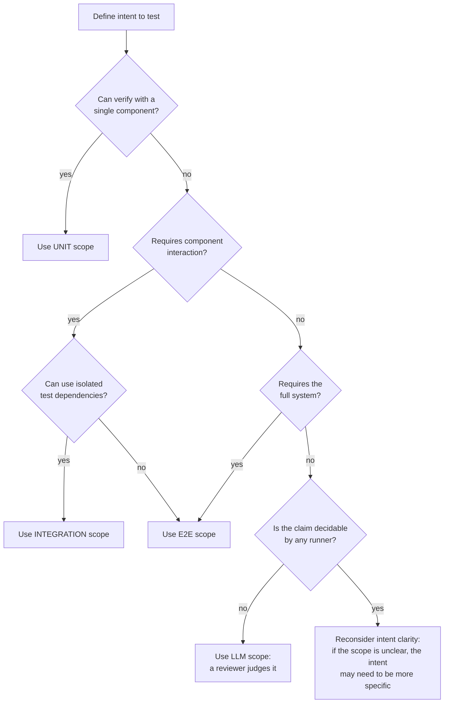

## Navigation

- **Parent**: [Testing Overview](./00-OVERVIEW.md)

---

## 1. Overview

Test scope defines the level of isolation and integration at which a test executes. Choosing the right scope is critical for effective intent testing.

> **Principle**: Test at the smallest scope that can verify the intent. Unit is always preferable.

**`llm` scope sits outside that ladder, and the principle does not order it.** `unit`, `integration` and `e2e` are degrees of isolation for a test that executes; `llm` names a claim that *no* test can decide, attested by a reviewer's recorded verdict instead (Intent Specification Standard, section 3.3). So the choice is not "how small a test", it is "is this decidable by a runner at all". Reach for `llm` only when the answer is no: a claim about meaning, where any mechanical check would be an approximation standing in for a judgement. When a runner can decide it, the ladder applies and the smallest rung wins.

---

## 2. Scope Definitions

### 2.1 Unit Scope

| Characteristic | Specification |
|----------------|---------------|
| **Isolation** | Complete - no external dependencies |
| **Speed** | < 100ms per test |
| **Dependencies** | Mocked/stubbed |
| **Database** | None (in-memory if needed) |
| **Network** | None |
| **File System** | None (virtual if needed) |

**Use for**:

- Single component logic
- Data transformations
- Business rule validation
- Input validation
- Invariants that can be verified in isolation

### 2.2 Integration Scope

| Characteristic | Specification |
|----------------|---------------|
| **Isolation** | Partial - some real dependencies |
| **Speed** | < 5 seconds per test |
| **Dependencies** | Real or test containers |
| **Database** | Test database or container |
| **Network** | Local only |
| **File System** | Temporary directories |

**Use for**:

- Component interactions
- Database operations
- Message queue behavior
- Contract verification between services
- Cache behavior

### 2.3 E2E Scope

| Characteristic | Specification |
|----------------|---------------|
| **Isolation** | None - full system |
| **Speed** | < 60 seconds per test |
| **Dependencies** | All real |
| **Database** | Real (test environment) |
| **Network** | Real HTTP/messaging |
| **File System** | Real |

**Use for**:

- User-visible workflows
- Cross-service behavior
- System-wide invariants
- Acceptance criteria validation

---

## 3. Scope Comparison

| Aspect | Unit | Integration | E2E |
|--------|------|-------------|-----|
| **Speed** | Milliseconds | Seconds | Tens of seconds |
| **Reliability** | Very high | High | Medium |
| **Debugging** | Easy | Medium | Hard |
| **Coverage** | Narrow | Medium | Wide |
| **Cost to maintain** | Low | Medium | High |
| **Feedback time** | Immediate | Fast | Slow |

---

## 4. Scope Selection Decision Tree



---

## 5. Scope Guidelines by Intent Type

### 5.1 Invariants

| Intent Pattern | Recommended Scope |
|----------------|-------------------|
| "X must never Y" | Unit (if possible) |
| "Data must always be Z" | Unit |
| "Across the system, X must Y" | Integration or E2E |

**Example**:

```yaml
statement: "Passwords must never be stored in plaintext"
test: { scope: unit }  # Can verify in PasswordService alone
```

### 5.2 Behaviors

| Intent Pattern | Recommended Scope |
|----------------|-------------------|
| "When X, the system returns Y" | Depends on X |
| "Service A calls Service B" | Integration |
| "User can complete workflow" | E2E |

**Example**:

```yaml
statement: "Valid login credentials must return a session token"
test: { scope: integration }  # Requires auth service + user repository
```

### 5.3 Contracts

| Intent Pattern | Recommended Scope |
|----------------|-------------------|
| "API returns X for input Y" | Unit or Integration |
| "Error responses include Z" | Unit |
| "Services communicate via protocol X" | Integration |

**Example**:

```yaml
statement: "API must return 400 for malformed JSON"
test: { scope: unit }  # Can test request parser in isolation
```

---

## 6. Scope Anti-Patterns

### 6.1 E2E When Unit Would Suffice

[NO] **Wrong**:

```yaml
statement: "Email addresses must be validated"
test: { scope: e2e }  # Overkill for simple validation
```

[OK] **Right**:

```yaml
statement: "Email addresses must be validated"
test: { scope: unit }  # EmailValidator can be tested in isolation
```

### 6.2 Unit When Integration Required

[NO] **Wrong**:

```yaml
statement: "Database transactions must be atomic"
test: { scope: unit }  # Can't verify without real database
```

[OK] **Right**:

```yaml
statement: "Database transactions must be atomic"
test: { scope: integration }  # Requires real DB to test atomicity
```

### 6.3 Mocking Away the Intent

[NO] **Wrong**: the test mocks the very component the claim governs, so the assertion verifies the mock, not the isolation behavior.

[OK] **Right**: the test exercises the real component under test (its outbound dependencies may be doubled) and asserts the claimed behavior on it.

---

## 7. Scope Performance Requirements

| Scope | Individual Test | Full Suite |
|-------|-----------------|------------|
| Unit | < 100ms | < 2 minutes |
| Integration | < 5s | < 10 minutes |
| E2E | < 60s | < 30 minutes |

### 7.1 If Tests Are Slow

- **Slow unit test?**  ->  Check for hidden I/O, convert to integration
- **Slow integration test?**  ->  Optimize test containers, parallelize
- **Slow E2E test?**  ->  Review if truly needed, consider breaking down

---

## 8. Test Environment by Scope

| Scope | Database | External Services | Configuration |
|-------|----------|-------------------|---------------|
| Unit | None/in-memory | Mocked | Embedded |
| Integration | Test containers | Test doubles/containers | Test profile |
| E2E | Test environment DB | Test environment services | Test environment |

---

## Change Log

| Version | Date | Author | Changes |
|---------|------|--------|---------|
| 1.1.0 | 2026-07-04 | CSD Team | Scope decision tree in Mermaid |
| 1.0.0 | 2026-07-04 | CSD Team | Scope rules stated at methodology level; canonical test binding in examples; promoted to Active |
| 0.1.0 | 2026-02-04 | CSD Team | Initial scope definitions |
