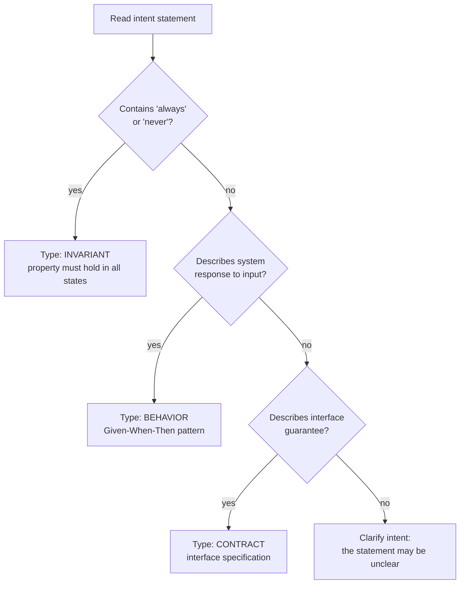

## Navigation

- **Parent**: [Testing Overview](./00-OVERVIEW.md)

---

## 1. Overview

Test types classify tests by WHAT they verify. In CSD, there are three primary test types aligned with intent categories.

---

## 2. Test Types Summary

| Type | Purpose | Tests That... | Example |
|------|---------|---------------|---------|
| **Invariant** | Conditions that must ALWAYS hold | Property is always true | "Passwords never stored plaintext" |
| **Behavior** | Expected responses to inputs | System responds correctly | "Login returns session" |
| **Contract** | Interface guarantees | Interfaces behave as promised | "API returns 400 for bad input" |

---

## 3. Invariant Tests

### 3.1 Definition

Invariant tests verify conditions that must **ALWAYS** be true, regardless of input, state, or timing.

### 3.2 Characteristics

| Aspect | Invariant Tests |
|--------|-----------------|
| **Assertion** | "Always true" or "Never happens" |
| **Failure meaning** | Critical system violation |
| **Test style** | Property-based, exhaustive, or fuzzing |
| **Scope** | Usually unit, sometimes integration |

### 3.3 Patterns

An invariant test proves the property over the input space, not over one example: generate arbitrary inputs (property-based testing) or enumerate every state the property must survive (exhaustive testing), and assert the property on each.

### 3.4 Good Invariant Intent Patterns

| Pattern | Example |
|---------|---------|
| "X must never Y" | "Credentials must never appear in logs" |
| "X must always Y" | "Audit events must always include timestamp" |
| "Regardless of Z, X must Y" | "Regardless of load, sessions must be isolated" |

---

## 4. Behavior Tests

### 4.1 Definition

Behavior tests verify that the system **responds correctly** to specific inputs or events.

### 4.2 Characteristics

| Aspect | Behavior Tests |
|--------|----------------|
| **Assertion** | "Given X, when Y, then Z" |
| **Failure meaning** | Feature broken |
| **Test style** | Given-When-Then / Arrange-Act-Assert |
| **Scope** | Any (unit, integration, e2e) |

<!-- `llm` claims carry a type but no executing test -->

### 4.3 Patterns

A behavior test reads as Given-When-Then: establish the precondition, perform the action the statement names, and assert the promised response. Cover the negative case (the same action under invalid input) alongside the positive one.

### 4.4 Good Behavior Intent Patterns

| Pattern | Example |
|---------|---------|
| "When X, system must Y" | "When order placed, inventory must decrease" |
| "X must result in Y" | "Login with valid credentials must return token" |
| "On event X, Y must happen" | "On payment failure, order must be cancelled" |

---

## 5. Contract Tests

### 5.1 Definition

Contract tests verify that **interfaces behave as promised** to their consumers.

### 5.2 Characteristics

| Aspect | Contract Tests |
|--------|----------------|
| **Assertion** | "Interface guarantees X" |
| **Failure meaning** | API contract broken |
| **Test style** | Input/output validation, schema testing |
| **Scope** | Unit or integration |

### 5.3 Patterns

A contract test exercises the interface from the consumer's side and asserts the promise: the guaranteed field or header is present, the error format holds, the response validates against its published schema.

### 5.4 Good Contract Intent Patterns

| Pattern | Example |
|---------|---------|
| "API must return X for Y" | "API must return 404 for unknown resources" |
| "Response must include X" | "Error responses must include error code" |
| "Interface must accept X" | "API must accept JSON and XML content types" |

---

## 6. Type Selection Guide

---

## 7. Type x Scope Matrix

| Type | Unit | Integration | E2E |
|------|------|-------------|-----|
| **Invariant** | [OK] Primary | [WARN] If needed | [NO] Rare |
| **Behavior** | [OK] Simple logic | [OK] Interactions | [OK] Workflows |
| **Contract** | [OK] Parsers, validators | [OK] APIs | [NO] Rare |

### 7.1 Recommended Combinations

| Intent Pattern | Type | Scope |
|----------------|------|-------|
| "Data must never leak" | Invariant | Unit |
| "Login returns token" | Behavior | Integration |
| "API returns 400 for bad input" | Contract | Unit |
| "User can checkout" | Behavior | E2E |
| "Sessions isolated across users" | Invariant | Unit |
| "Services communicate via events" | Contract | Integration |

---

## 8. Anti-Patterns

### 8.1 Invariant as Behavior

[NO] **Wrong**: "login with valid credentials succeeds" classified as `invariant`. It describes a response to a specific input, so it is a behavior.

[OK] **Right**: classify it as `behavior`; reserve `invariant` for statements like "sessions never expose the password hash", which must hold in every state.

### 8.2 Single-Example Invariants

[NO] **Wrong**: an invariant test that checks one hand-picked input ("hash `password123`, assert the hash does not contain it") proves nothing about the property.

[OK] **Right**: verify the property over generated inputs (property-based) or an exhaustive enumeration, so the test earns the word "never".

---

## Change Log

| Version | Date | Author | Changes |
|---------|------|--------|---------|
| 1.1.0 | 2026-07-04 | CSD Team | Type selection tree in Mermaid |
| 1.0.0 | 2026-07-04 | CSD Team | Type rules stated at methodology level; framework annotation catalog removed; promoted to Active |
| 0.1.0 | 2026-02-04 | CSD Team | Initial test types standard |
