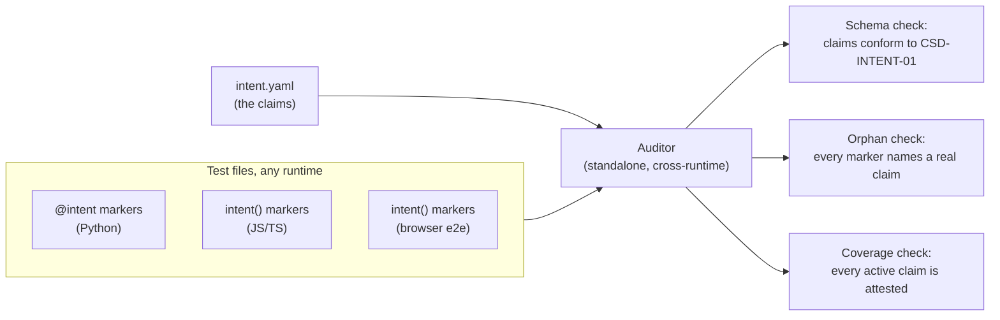

## Navigation

- **Parent**: [Testing Overview](./00-OVERVIEW.md)

---

## 1. Overview

This guide defines how an intent claim becomes a runnable test: the marker contract every test runtime implements, and the audit that holds claims and tests together. The methodology prescribes the contract; each runtime binds it to its own test framework.

---

## 2. The Marker Contract

A test attests a claim by carrying an `intent` marker with the claim's ID. Any runtime binding MUST provide:

| Requirement | Specification |
|-------------|---------------|
| Marker | A way for a test to declare the claim ID(s) it attests, readable by static scan |
| Claim ID validation | The marker rejects IDs that do not match the [ID rules](../01-INTENT/01-SPECIFICATION.md) |
| Multi-claim | One test MAY attest several claims |
| Transparency | The marker delegates to the framework's native test function; it adds no behavior |

The marker is deliberately tiny: it annotates, it does not validate. Schema validation, orphan detection, and coverage checking belong to the auditor (Section 4), which reads markers across all runtimes in one pass.

---

## 3. Runtime Bindings

### 3.1 Python (pytest)

A decorator on the test function:

```python
from pytest_intent import intent

@intent("INT-001")
def test_session_data_never_crosses_user_boundaries():
    ...

@intent("INT-021", "INT-022")  # one test attests two claims
def test_referential_integrity():
    ...
```

### 3.2 JS/TS (vitest)

A wrapper around `test()`:

```typescript
import { intent } from 'vitest-intent';

intent('INT-001', 'session data never crosses user boundaries', () => {
    /* ... */
});

intent(['INT-002', 'INT-003'], 'parses and validates the token', () => {
    /* ... */
});
```

### 3.3 Browser E2E (Playwright)

The same wrapper shape; Playwright fixtures pass through:

```typescript
import { intent } from 'playwright-intent';

intent('INT-007', 'dashboard loads with summary cards', async ({ page }) => {
    await page.goto('/');
    await expect(page.getByText('REPOSITORIES')).toBeVisible();
});
```

All three bindings expose the same marker shape, so a project can mix runtimes and still be audited as one.

---

## 4. Auditing



A standalone auditor (CLI, CI step, or pre-commit hook) reads `intent.yaml` and every test file, and answers three questions:

| Check | Question | Failure |
|-------|----------|---------|
| Schema | Does every claim conform to [CSD-INTENT-01](../01-INTENT/01-SPECIFICATION.md)? | Malformed claim |
| Orphan | Does every marker reference a real claim? | Marker points at a claim that does not exist |
| Coverage | Does every active claim have at least one attesting test, in any runtime? | Unattested claim |

The audit runs standalone rather than inside any one test suite, because coverage is a cross-runtime property: a claim may be attested by a pytest test, a vitest test, or an e2e test, and only a whole-project scan can see all of them.

---

## 5. Implementation Checklist

Before submitting an intent test:

- [ ] Test carries the `intent` marker with the correct claim ID(s)
- [ ] Test name reflects the claim statement, not the implementation
- [ ] Test executes at the claim's declared scope
- [ ] Invariants are verified property-based or exhaustively, not on one example
- [ ] Test is isolated (no shared state between tests)
- [ ] The audit passes: no orphan markers, no unattested active claims

---

## Change Log

| Version | Date | Author | Changes |
|---------|------|--------|---------|
| 1.1.0 | 2026-07-04 | CSD Team | Audit model in Mermaid |
| 1.0.0 | 2026-07-04 | CSD Team | Rebuilt as the marker contract and audit model; per-framework implementation catalogs removed; promoted to Active |
| 0.1.0 | 2026-02-04 | CSD Team | Initial implementation guide |
