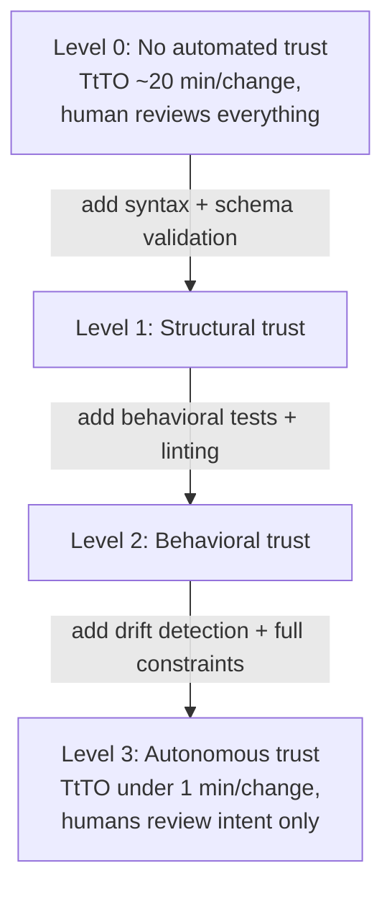

## Navigation

- **Parent**: [Testing Strategy Overview](./00-OVERVIEW.md)

---

## 1. Overview

**Trust Calibration** is the practice of assigning different levels of automated and human validation to different artifact types, based on the risk profile of each artifact and the maturity of its executable constraints.

Not all AI output needs the same level of scrutiny. Treating all output as equally untrustworthy is wasteful; treating all output as equally trustworthy is reckless. Trust Calibration finds the right level.

> **Principle**: Human attention should be proportional to trust risk, not proportional to diff size.

---

## 2. The Trust Spectrum

Different artifacts have different trust profiles:

| Artifact Type | Trust Mechanism | Human Review | Target TtTO |
|---------------|----------------|--------------|-------------|
| **Code** (well-constrained) | Tests + types + linting + constraints | Periodic spot-check | < 5 min |
| **Code** (novel/architectural) | Tests + human architectural review | Always | < 1 day |
| **Intent specifications** | Human approval required | Always | < 1 day |
| **Documentation** | Automated validation suite | Explanation accuracy only | < 2 min |
| **Configuration** | Schema + policy validation | None (if policies are comprehensive) | < 1 min |
| **Test code** | Meta-tests + coverage analysis | Periodic review | < 10 min |

### 2.1 The Key Insight

Trust is not binary. It is a **calibrated property** that depends on:

1. **Constraint maturity**: How comprehensive are the executable constraints for this artifact type?
2. **Failure history**: How often has AI-generated output of this type been wrong?
3. **Blast radius**: What happens if a bad artifact reaches production?
4. **Reversibility**: How easy is it to roll back?

---

## 3. Trust Levels

### 3.1 Level 0: No Automated Trust

- No executable constraints exist
- Every artifact requires full human review
- TtTO is dominated by T_review
- **This is where most organizations start with AI**

### 3.2 Level 1: Structural Trust

- Syntax, schema, and type validation automated
- Human reviews logic and meaning
- TtTO reduced by eliminating structural review
- **Minimum viable trust**

### 3.3 Level 2: Behavioral Trust

- Tests validate behavior against intent
- Linting enforces patterns and conventions
- Human reviews architectural decisions only
- **Sweet spot for most artifact types**

### 3.4 Level 3: Autonomous Trust

- Comprehensive executable constraints
- Drift detection catches architectural regression
- Human review periodic, not per-change
- AI can iterate autonomously within constraints
- **The goal for well-constrained domains**

---

## 4. Calibrating Review by Artifact Type

### 4.1 Code: The Progressive Trust Model

For code, trust can progressively shift from human to automated:

**Always review**:

- Changes to intent specifications
- New architectural patterns
- Security-critical code paths
- Dependency changes

**Periodically review** (spot-check for drift):

- Implementation patterns in well-constrained domains
- Test implementations (are they testing the right thing?)
- Refactoring changes within existing architecture

**Trust the constraints** (no per-change review needed):

- Bug fixes where tests define correctness
- Formatting and style changes
- Boilerplate and scaffolding
- Changes within well-tested modules

### 4.2 Intent: Always Human-Reviewed, AI-Accelerated

Intent defines meaning. It must always be human-approved. But the process can be AI-accelerated:

- AI surfaces contradictions: "This intent conflicts with INT-042"
- AI suggests edge cases: "What about concurrent sessions?"
- AI drafts specifications from observed failures (Emergent Intent)
- Human approves, rejects, or refines - always the final decision

TtTO for intent is measured by **how fast AI suggestions reach the human decision point**, not by whether the human is removed from the loop.

### 4.3 Documentation: Validated Accuracy, Reviewed Explanations

The generated-docs audit (see [Emergent Intent](../01-INTENT/04-EMERGENT-INTENT.md)) demonstrated that most documentation trust issues are factual, not conceptual:

- Wrong service names (caught by tests)
- Invalid API paths (caught by tests)
- Broken links (caught by tests)
- Inconsistent terminology (caught by tests)

Human review can then focus on **whether the explanation is clear and correct**, not whether the facts are right.

---

## 5. Drift Detection

Even at Level 3 (Autonomous Trust), the system needs a mechanism to detect when constraints themselves have drifted from the actual requirements:

### 5.1 Constraint Drift

- Executable constraints become outdated as the system evolves
- Tests pass but no longer test the right thing
- AI can assist: "This test hasn't been updated since the SessionService was refactored"

### 5.2 Architectural Drift

- Implementation patterns diverge from intended architecture
- New patterns emerge that aren't captured in constraints
- Regular architectural review (human + AI-assisted analysis)

### 5.3 Intent Drift

- Business rules change but intent specifications don't update
- Emergent intent signals that authored intent is incomplete
- Frequency of emergent intent captures indicates authored intent maturity

---

## 6. Measuring Trust Calibration

| Metric | Description | Target |
|--------|-------------|--------|
| **Trust Level per Artifact Type** | What level each artifact type has reached | All at Level 2+ |
| **TtTO per Artifact Type** | Actual time from generation to trusted | See Section 2 table |
| **Emergent Intent Rate** | New emergent intents per week | Decreasing over time |
| **False Trust Rate** | Issues that passed constraints but were wrong | < 1% |
| **Review Efficiency** | % of human review time spent on meaningful decisions | > 80% |

---

## 7. Relationship to Other CSD Concepts

- **TtTO**: Trust Calibration is the primary lever for reducing TtTO
- **Emergent Intent**: Each captured emergent intent improves trust calibration for that failure class
- **Continuous Enforcement**: The enforcement pipeline implements the trust levels
- **Cognitive Modes**: Trust calibration determines what human review each mode must perform

---

## Change Log

| Version | Date | Author | Changes |
|---------|------|--------|---------|
| 1.1.0 | 2026-07-04 | CSD Team | Trust ladder in Mermaid |
| 1.0.0 | 2026-07-04 | CSD Team | Case study genericized; promoted to Active |
| 0.1.0 | 2026-04-17 | CSD Team | Initial trust calibration guide |
