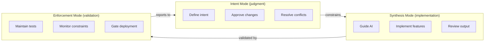
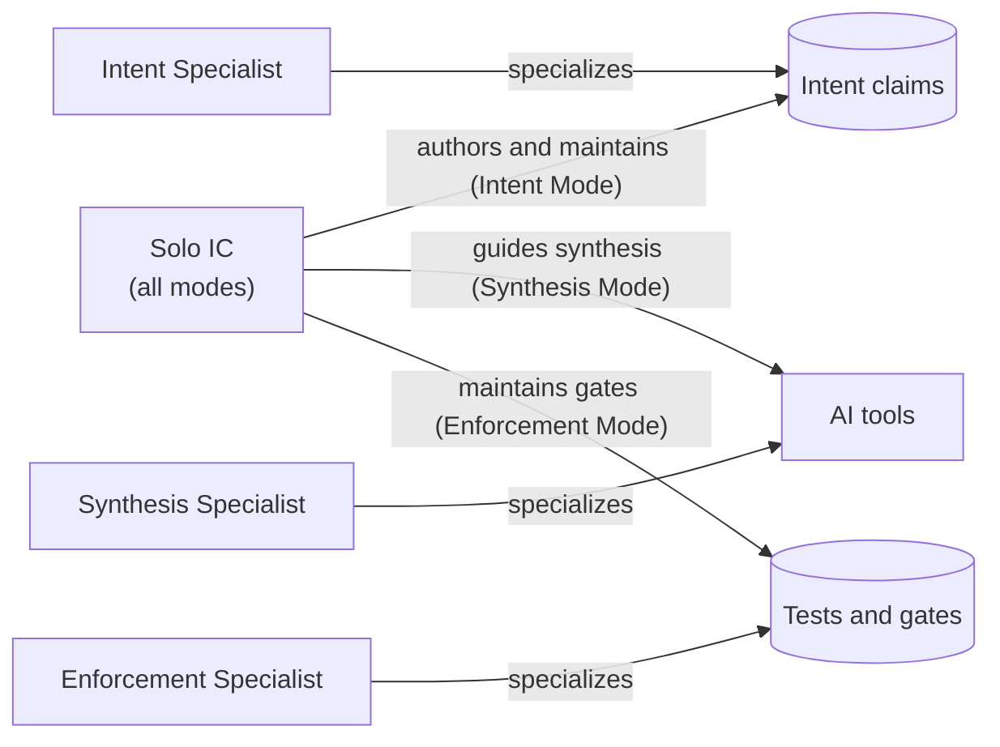
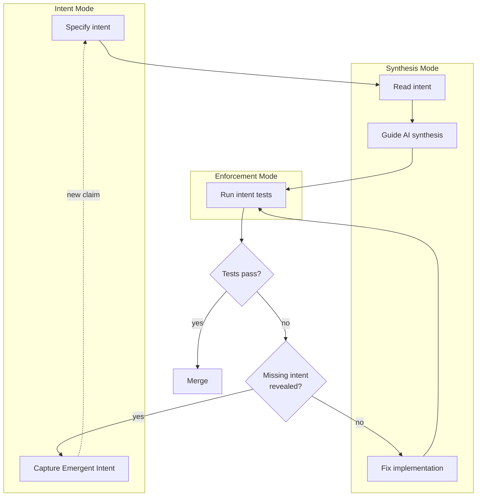

## Navigation

- **Parent**: [CSD Overview](../00-OVERVIEW.md)
- **Children**:
  - [Intent Mode](./01-INTENT-MODE.md)
  - [Synthesis Mode](./02-SYNTHESIS-MODE.md)
  - [Enforcement Mode](./03-ENFORCEMENT-MODE.md)
  - [Team Topologies](./04-TEAM-TOPOLOGIES.md)

---

## 1. Introduction

Cognitive Software Delivery introduces **Cognitive Modes** - not fixed job titles, but hats that individuals wear depending on the task at hand. These modes reflect the **separation of judgment and synthesis** that is fundamental to CSD.

> **Core Principle**: Humans define meaning. Machines synthesize. Tests enforce.

This separation requires explicit awareness of which mode you're operating in, but does **not** require separate people for each mode.

---

## 2. Why Modes, Not Roles?

### 2.1 The Scaling Problem

Fixed roles don't scale in both directions:

- **Solo IC on a low-cost project**: One person must do everything. Three "roles" is meaningless overhead.
- **Corporate resource pool**: 50 ICs each running a project. Each person operates in all modes. Assigning three people per project is unaffordable.

CSD uses **Cognitive Modes** because:

- A single IC can operate in all three modes (solo project)
- A small team can have individuals shift between modes (2-3 person team)
- A large team can have individuals specialize in a primary mode (scaled delivery)
- A resource pool can have shared experts who operate in one mode across many projects

### 2.2 How Traditional Roles Map

In traditional delivery, a "developer" does everything. CSD makes the cognitive shifts *explicit* so they can be optimized:

| When you are... | You are in... |
|----------------|---------------|
| Deciding what must be true | **Intent Mode** |
| Guiding AI to implement it | **Synthesis Mode** |
| Making sure tests and constraints hold | **Enforcement Mode** |

### 2.3 The Separation Principle



---

## 3. CSD Cognitive Modes

| Mode | Focus | Key Activities |
|------|-------|----------------|
| **Intent Mode** | WHAT must be true | Author intent, approve AI-drafted intent, resolve conflicts, review emergent intent |
| **Synthesis Mode** | HOW to implement | Guide AI, review synthesized code, ensure intent compliance, optimize |
| **Enforcement Mode** | Does it HOLD? | Maintain test infra, monitor quality gates, track TtTO, escalate drift |

### 3.1 Mode Distribution



---

## 4. Modes at a Glance

### 4.1 Intent Mode

**Focus**: WHAT must be true

- Authors intent specifications
- Reviews AI-drafted intent
- Approves emergent intent from synthesis failures
- Resolves intent conflicts

See: [Intent Mode](./01-INTENT-MODE.md)

### 4.2 Synthesis Mode

**Focus**: HOW to implement

- Guides AI code generation
- Reviews synthesized code
- Ensures intent compliance
- Optimizes implementation

See: [Synthesis Mode](./02-SYNTHESIS-MODE.md)

### 4.3 Enforcement Mode

**Focus**: Does it HOLD?

- Maintains test infrastructure
- Monitors trust calibration and TtTO
- Captures emergent intent from failures
- Escalates systematic drift

See: [Enforcement Mode](./03-ENFORCEMENT-MODE.md)

---

## 5. Mode Interactions

### 5.1 Intent Flow



### 5.2 Conflict Resolution

| Conflict | Resolution |
|----------|------------|
| Implementation can't satisfy intent | Switch to Intent Mode, review intent |
| Multiple valid implementations | Synthesis Mode decides |
| Test infrastructure issue | Enforcement Mode resolves |
| Intent is ambiguous | Intent Mode clarifies |
| Synthesis failure reveals missing intent | Capture as Emergent Intent |

---

## 6. Scaling Topologies

### 6.1 Solo IC (1-Person Project)

The primary CSD use case for low-cost, high-throughput delivery:

```text
1 IC operates in all three modes:
  - Intent Mode:      Define what must be true (10% of time)
  - Synthesis Mode:   Guide AI to build it (70% of time)
  - Enforcement Mode: Maintain tests and constraints (20% of time)
```

One person, one project. AI handles the volume. Modes provide cognitive discipline. TtTO is measured per artifact, not per person.

### 6.2 Small Team (2-3 People)

```text
IC 1: Primarily Intent + Enforcement Mode (architect/lead)
IC 2: Primarily Synthesis Mode (implementer)
IC 3: Primarily Synthesis Mode (implementer) [optional]
```

All can shift modes as needed. The lead spends more time in Intent Mode; implementers spend more time in Synthesis Mode.

### 6.3 Resource Pool (N ICs x M Projects)

The corporate-scale model: a shared pool of ICs, each running 1 project:

```text
Resource Pool (e.g., 20 ICs):
  |-  IC 1   ->  Project A (all modes)
  |-  IC 2   ->  Project B (all modes)
  |-  ...
  |-  IC 19  ->  Project S (all modes)
  `-  IC 20  ->  Project T (all modes)

Shared Specialists:
  |-  Intent Specialist   ->  Reviews intent across all projects (20% per project)
  |-  Enforcement Specialist  ->  Maintains shared test infra, monitors TtTO
  `-  Architecture Review  ->  Periodic drift checks across all projects
```

This scales because:

- Each IC handles a full project autonomously (all 3 modes)
- Shared specialists provide cross-project governance without per-project overhead
- TtTO is the unified metric across the pool
- Emergent intent from one project feeds into shared intent libraries for all projects

### 6.4 Large Team (10+ People, 1 Large Project)

```text
Intent Specialists:    2-3 (primarily Intent Mode)
Synthesis Specialists: 6-10 (primarily Synthesis Mode)
Enforcement Specialists: 1-2 (primarily Enforcement Mode)
```

Specialization becomes worth the coordination cost at this scale.

---

## 7. Mapping from Traditional Teams

### 7.1 For Existing Developers

| Current Role | CSD Mode Mapping |
|--------------|-----------------|
| Senior Developer | All modes (emphasis on Intent) |
| Mid-level Developer | Primarily Synthesis Mode |
| Junior Developer | Synthesis Mode (with Intent Mode guidance) |
| Tech Lead | Primarily Intent Mode |
| Architect | Intent Mode (cross-cutting) |

### 7.2 For Existing QA

| Current Role | CSD Mode Mapping |
|--------------|-----------------|
| QA Engineer | Enforcement Mode + Synthesis Mode (test implementation) |
| QA Lead | Enforcement Mode |
| Security Engineer | Intent Mode (security intents) + Enforcement Mode |

### 7.3 For Existing Product

| Current Role | CSD Mode Mapping |
|--------------|-----------------|
| Product Owner | Provides input to Intent Mode |
| Business Analyst | Provides input to Intent Mode |

---

## 8. Transition Path

For teams adopting CSD:

### Phase 1: Identify Cognitive Modes

1. Map current team members to CSD cognitive modes
2. Identify gaps in mode coverage
3. Define rotation schedule (if needed)

### Phase 2: Establish Intent Ownership

1. Designate practitioners for Intent Mode per domain
2. Begin writing intent specifications
3. Train on intent writing

### Phase 3: Enable Synthesis

1. Train practitioners on AI tools for Synthesis Mode
2. Establish intent-to-implementation workflow
3. Build feedback loops

### Phase 4: Harden Enforcement

1. Practitioners in Enforcement Mode build test infrastructure
2. Enable intent test gating
3. Monitor and tune

---

## 9. Quick Reference

| Question | Answer |
|----------|--------|
| Who writes intent specs? | Practitioner in Intent Mode |
| Who writes production code? | Practitioner in Synthesis Mode (with AI) |
| Who writes intent tests? | Practitioner in Synthesis Mode, guided by Intent Mode |
| Who maintains test infra? | Practitioner in Enforcement Mode |
| Who approves intent changes? | Practitioner in Intent Mode |
| Who can override failing tests? | No one (escalate to Intent Mode) |

---

## Change Log

| Version | Date | Author | Changes |
|---------|------|--------|---------|
| 1.1.0 | 2026-07-04 | CSD Team | Mode separation, distribution, and intent flow in Mermaid |
| 1.0.0 | 2026-07-04 | CSD Team | Intent flow rendered as a diagram; promoted to Active |
| 0.1.0 | 2026-02-04 | CSD Team | Initial team structures overview |
