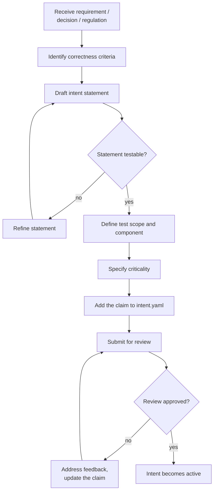

## Navigation

- **Parent**: [Team Structures Overview](./00-OVERVIEW.md)

---

## 1. Mode Definition

**Intent Mode** is the cognitive mode focused on defining and maintaining the intent specifications that govern system correctness.

> When operating in Intent Mode, the practitioner answers: **"What must be true for this system to be correct?"**

Intent Mode is not a job title. Any team member can enter Intent Mode when the task requires defining, reviewing, or maintaining intent. In a solo IC setup, one person wears this hat alongside Synthesis Mode and Enforcement Mode. In larger teams, individuals may specialize.

---

## 2. Responsibilities

### 2.1 Primary Responsibilities

| Responsibility | Description |
|----------------|-------------|
| **Author Intent** | Write clear, testable intent specifications |
| **Maintain Intent** | Keep intent current as requirements evolve |
| **Review Changes** | Approve modifications to owned intents |
| **Resolve Conflicts** | Mediate when intents conflict or are ambiguous |
| **Traceability** | Link intent to requirements, decisions, regulations |

### 2.2 What Intent Mode Does NOT Cover

| Activity | Why Not |
|----------|---------|
| Write production code | Separation of judgment and synthesis |
| Choose technology | Technology-agnostic intent |
| Implement features | That belongs in Synthesis Mode |
| Override test failures | Tests enforce intent; changing intent is the remedy |

---

## 3. Skills Required

### 3.1 Essential Skills

| Skill | Why Important |
|-------|---------------|
| **Domain Knowledge** | Must understand business rules to encode them |
| **Clear Communication** | Intent must be unambiguous |
| **Systems Thinking** | Must see cross-cutting implications |
| **Technical Background** | Must understand what is testable |

### 3.2 Desirable Skills

- Experience with requirements engineering
- Understanding of security and compliance
- Familiarity with testing concepts
- Experience with architectural decisions

---

## 4. Activities

### 4.1 Day-to-Day

```text
Morning
|- Review pending intent change requests
|- Clarify ambiguous intents raised during synthesis
`- Participate in design discussions (intent perspective)

Ongoing
|- Write new intent specs for new features
|- Update existing intents for changing requirements
`- Review intent test results for pattern issues

Weekly
|- Intent review session with team
|- Sync with other practitioners in Intent Mode (cross-cutting concerns)
`- Review intent coverage metrics
```

### 4.2 Intent Authoring Workflow



---

## 5. Ownership Model

### 5.1 Domain-Based Ownership

Practitioners operating in Intent Mode typically own intents within a domain:

| Domain | Typical Intents | Practitioner Profile |
|--------|-----------------|----------------------|
| Security | Authentication, authorization, data protection | Security-focused tech lead |
| Data | Data integrity, consistency, validity | Data architect |
| Business | Business rules, workflows, calculations | Senior developer with domain expertise |
| Integration | API contracts, event schemas | Integration specialist |

### 5.2 Ownership Assignment

Ownership is recorded per domain, not per claim: each domain names an owner and a backup, and claims carry their `domain` field. A claim's owner is derivable, and reassignment touches one registry entry instead of every claim.

### 5.3 Ownership Transfer

When an intent owner leaves or changes team:

1. Assign new owner
2. Knowledge transfer session
3. New owner reviews all owned intents
4. Update ownership registry
5. New owner acknowledges ownership

---

## 6. Decision Rights

### 6.1 Decisions Made in Intent Mode

| Decision | Example |
|----------|---------|
| Intent statement | "What exactly must be true?" |
| Test scope | "Is unit sufficient or do we need integration?" |
| Criticality | "Is this critical or high?" |
| Deprecation | "Is this intent still needed?" |

### 6.2 Decisions to Escalate

| Decision | Escalate To |
|----------|-------------|
| Conflicting intents across domains | Architecture / Lead practitioners |
| Business rule clarification | Product / Business |
| Regulatory interpretation | Compliance / Legal |
| Technology constraints preventing intent | Architecture |

---

## 7. Interactions with Other Modes

### 7.1 With Synthesis Mode

| Interaction | Intent Mode Practitioner's Action |
|-------------|-----------------------------------|
| Feature implementation starts | Provide relevant intents |
| Clarification needed | Answer questions about intent meaning |
| Implementation cannot satisfy intent | Review if intent is correct |
| New intent discovered during synthesis | Author the new intent (Emergent Intent) |

### 7.2 With Enforcement Mode

| Interaction | Intent Mode Practitioner's Action |
|-------------|-----------------------------------|
| Test failing persistently | Determine if intent or implementation issue |
| Coverage gap identified | Prioritize missing intent tests |
| Quality metric declining | Review related intents |

### 7.3 With Stakeholders

| Interaction | Intent Mode Practitioner's Action |
|-------------|-----------------------------------|
| New requirement | Translate to intent |
| Requirement change | Update related intents |
| Compliance audit | Explain intent traceability |

---

## 8. Anti-Patterns

### 8.1 What to Avoid

| Anti-Pattern | Problem | Solution |
|--------------|---------|----------|
| Vague intent | "The system should work well" | Write specific, testable statements |
| Technology in intent | "Must use bcrypt" | "Passwords must use adaptive hashing" |
| Too many intents | Overhead, hard to maintain | Focus on critical correctness |
| No rationale | Cannot justify decisions | Always include why |
| Single point of failure | One person owns everything | Backup owners, domain distribution |

---

## 9. Metrics

### 9.1 Intent Mode Effectiveness

| Metric | Target | Why |
|--------|--------|-----|
| Intent clarity | < 2 clarifications per intent | Clear intents need few questions |
| Intent stability | < 1 major change per quarter | Stable intents reduce churn |
| Coverage | 100% critical features | All important behavior has intent |
| Test pass rate | > 99% | Well-written intents are implementable |

---

## 10. Onboarding Checklist

For practitioners new to Intent Mode:

- [ ] Read the CSD overview
- [ ] Understand Intent Specification format
- [ ] Read 3 existing intent specs
- [ ] Write a draft intent (with guidance)
- [ ] Participate in intent review session
- [ ] Own first intent spec

---

## Change Log

| Version | Date | Author | Changes |
|---------|------|--------|---------|
| 1.1.0 | 2026-07-04 | CSD Team | Authoring workflow in Mermaid |
| 1.0.0 | 2026-07-04 | CSD Team | Ownership stated as a rule rather than a sample registry; promoted to Active |
| 0.2.0 | 2026-02-04 | CSD Team | Reframed as Intent Mode (Cognitive Modes) |
| 0.1.0 | 2026-02-04 | CSD Team | Initial draft |
