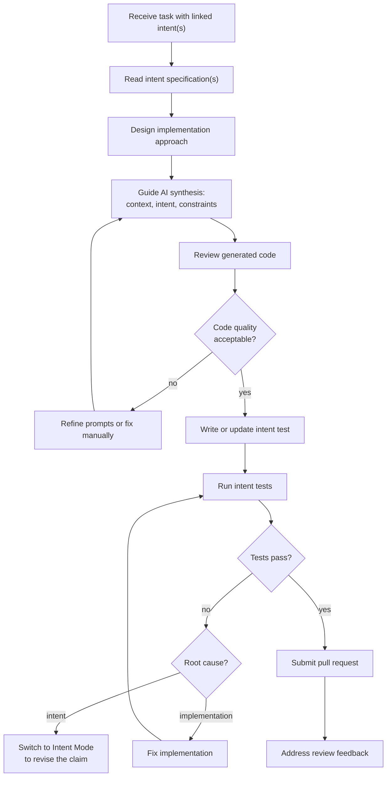

## Navigation

- **Parent**: [Team Structures Overview](./00-OVERVIEW.md)

---

## 1. Mode Definition

**Synthesis Mode** is the cognitive mode focused on guiding AI-assisted implementation to satisfy intent specifications.

> When operating in Synthesis Mode, the practitioner answers: **"How do we implement this correctly?"**

Synthesis Mode is not a job title. Any team member enters Synthesis Mode when writing code, guiding AI tools, or reviewing generated output. In a solo IC setup, one person alternates between this and the other modes.

---

## 2. Responsibilities

### 2.1 Primary Responsibilities

| Responsibility | Description |
|----------------|-------------|
| **Guide Synthesis** | Direct AI tools to generate compliant code |
| **Review Output** | Evaluate AI-generated code for correctness |
| **Implement Tests** | Write intent tests based on specifications |
| **Refine Implementation** | Optimize and improve generated code |
| **Ensure Compliance** | Verify implementation satisfies intent |

### 2.2 What Synthesis Mode Does NOT Cover

| Activity | Why Not |
|----------|---------|
| Define intent | That belongs in Intent Mode |
| Approve intent changes | Separation of judgment and synthesis |
| Skip failing intent tests | Tests are non-negotiable gates |
| Make architectural decisions alone | Consult Intent Mode for cross-cutting concerns |

---

## 3. Skills Required

### 3.1 Essential Skills

| Skill | Why Important |
|-------|---------------|
| **Programming Proficiency** | Must evaluate and refine code |
| **AI Tool Fluency** | Effective prompting and guidance |
| **Testing Expertise** | Write robust intent tests |
| **Critical Evaluation** | Identify issues in generated code |

### 3.2 Emerging Skills (CSD-Specific)

| Skill | Description |
|-------|-------------|
| **Prompt Engineering** | Craft effective prompts for AI tools |
| **Intent Interpretation** | Translate intent specs to implementation |
| **Synthesis Debugging** | Diagnose why AI produces wrong output |
| **Human-AI Collaboration** | Know when to use AI vs. manual coding |

---

## 4. Activities

### 4.1 Day-to-Day

```text
Implementation Cycle
|-  Read intent specification for task
|-  Design implementation approach
|-  Guide AI to generate code
|-  Review generated code
|-  Write/update intent tests
|-  Run tests and iterate
`-  Submit for review

Quality Activities
|-  Review AI-generated code from others
|-  Identify patterns in synthesis errors
`-  Improve prompts and workflows

Collaboration
|-  Switch to Intent Mode to ask clarifying questions
|-  Report implementation challenges
`-  Share effective synthesis patterns
```

### 4.2 Implementation Workflow



---

## 5. Working with AI Tools

### 5.1 Intent-Bound Prompting

Whatever the AI tool, an intent-bound prompt names four things:

| Element | Content |
|---------|---------|
| **Context** | The system, the component, the codebase conventions in play |
| **Intent** | The relevant claim(s), quoted verbatim from `intent.yaml` |
| **Task** | The specific deliverable |
| **Constraints** | Testability, patterns to follow, boundaries not to cross |

The claims go into the prompt verbatim, not paraphrased: paraphrase is where meaning leaks. A prompt that omits the intent element produces output that can only be judged by taste.

### 5.2 AI Tool Selection

| Task | Recommended Approach |
|------|----------------------|
| New component | AI generation with heavy guidance |
| Refactoring | AI-assisted with human review |
| Bug fix | Human-led with AI assistance |
| Performance optimization | Human-led, AI for suggestions |
| Intent test writing | AI draft, human refinement |

### 5.3 When NOT to Use AI

- Security-critical cryptographic code
- Code that has failed AI synthesis repeatedly
- Highly domain-specific logic requiring deep context
- Small, simple changes faster to type manually

---

## 6. Writing Intent Tests

### 6.1 Testing in Synthesis Mode

| Activity | Responsibility |
|----------|----------------|
| Understand test scope | Read intent spec, implement at correct level |
| Write test implementation | Code that validates intent statement |
| Ensure coverage | All aspects of intent are tested |
| Maintain tests | Update when implementation changes |

### 6.2 Test Writing Workflow

```text
1. Read intent specification
2. Identify test scenarios from examples (pass/fail)
3. Determine test patterns (property-based for invariants, etc.)
4. Write test class with correct annotations
5. Implement test methods
6. Run and verify tests catch violations
7. Submit with implementation
```

---

## 7. Interactions with Other Modes

### 7.1 With Intent Mode

| Interaction | Synthesis Mode Practitioner's Action |
|-------------|--------------------------------------|
| Receiving intent | Acknowledge, ask clarifying questions |
| Implementation challenge | Report, propose alternatives |
| Intent seems wrong | Escalate, do not change unilaterally |
| Discovered gap | Propose new intent (Emergent Intent) |

### 7.2 With Enforcement Mode

| Interaction | Synthesis Mode Practitioner's Action |
|-------------|--------------------------------------|
| Test infrastructure issues | Report, provide reproduction |
| Flaky tests | Help diagnose and fix |
| Coverage gaps | Prioritize with Enforcement Mode practitioner |

### 7.3 With Other Synthesis Practitioners

| Interaction | Action |
|-------------|--------|
| Knowledge sharing | Document effective prompts and patterns |
| Pair synthesis | Two practitioners guiding AI on complex tasks |
| Code review | Review AI-generated code from teammates |

---

## 8. Anti-Patterns

### 8.1 What to Avoid

| Anti-Pattern | Problem | Solution |
|--------------|---------|----------|
| Blind acceptance | Trusting AI output without review | Always review generated code |
| Prompt-and-pray | No structure in AI interaction | Use intent-bound prompting |
| Manual override | Skipping intent tests | Tests are non-negotiable |
| Over-synthesis | Using AI when manual is faster | Right tool for the task |
| Context amnesia | Not providing intent to AI | Always reference intent specs |

---

## 9. Career Development

### 9.1 Growing in Synthesis Mode

| Level | Characteristics |
|-------|-----------------|
| **Junior** | Follows established prompts, needs guidance on intent interpretation |
| **Mid-Level** | Creates effective prompts, interprets intent independently |
| **Senior** | Develops synthesis patterns, mentors others, contributes to tooling |
| **Principal** | Defines synthesis strategy, evaluates AI tools, shapes methodology |

---

## Change Log

| Version | Date | Author | Changes |
|---------|------|--------|---------|
| 1.1.0 | 2026-07-04 | CSD Team | Implementation workflow in Mermaid; prompting stated as an information contract |
| 1.0.0 | 2026-07-04 | CSD Team | Reviewed against practice; promoted to Active |
| 0.2.0 | 2026-02-04 | CSD Team | Reframed as Synthesis Mode (Cognitive Modes) |
| 0.1.0 | 2026-02-04 | CSD Team | Initial draft |
