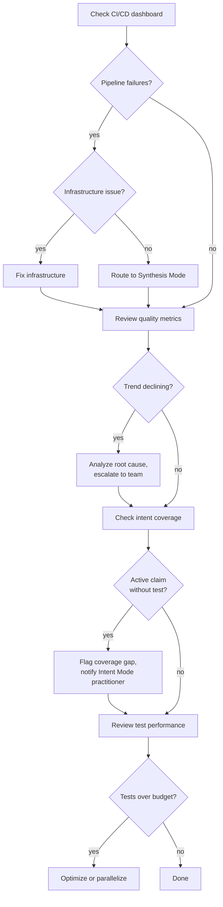

## Navigation

- **Parent**: [Team Structures Overview](./00-OVERVIEW.md)

---

## 1. Mode Definition

**Enforcement Mode** is the cognitive mode focused on ensuring that intent tests and quality gates remain effective and enforced.

> When operating in Enforcement Mode, the practitioner answers: **"Is our enforcement actually working?"**

Enforcement Mode is not a job title. Any team member enters Enforcement Mode when maintaining test infrastructure, monitoring quality metrics, or investigating systematic failures. In a solo IC setup, one person handles this alongside Intent Mode and Synthesis Mode.

---

## 2. Responsibilities

### 2.1 Primary Responsibilities

| Responsibility | Description |
|----------------|-------------|
| **Maintain Test Infrastructure** | Keep CI/CD, test runners, and tools healthy |
| **Ensure Gate Effectiveness** | Verify tests actually catch violations |
| **Monitor Quality Metrics** | Track and report on quality trends |
| **Escalate Systematic Issues** | Raise recurring patterns to team |
| **Enable Synthesis** | Provide tools and guidance for testing |

### 2.2 What Enforcement Mode Does NOT Cover

| Activity | Why Not |
|----------|---------|
| Define intent | That belongs in Intent Mode |
| Write production code | That belongs in Synthesis Mode |
| Override failing tests | Tests are non-negotiable |
| Make exceptions for deadlines | Integrity of enforcement |

---

## 3. Skills Required

### 3.1 Essential Skills

| Skill | Why Important |
|-------|---------------|
| **Test Engineering** | Build robust test infrastructure |
| **CI/CD Expertise** | Maintain pipelines and automation |
| **Metrics Analysis** | Interpret quality data meaningfully |
| **System Administration** | Manage test environments |

### 3.2 Desirable Skills

- Performance testing
- Security testing
- Chaos engineering
- Developer experience (DX)

---

## 4. Activities

### 4.1 Day-to-Day

```text
Morning
|- Check CI/CD pipeline health
|- Review overnight test failures
`- Triage flaky test reports

Ongoing
|- Investigate failing intent tests
|- Support practitioners in Synthesis Mode with test issues
|- Update test tooling and dependencies
`- Monitor test execution times

Weekly
|- Quality metrics review
|- Intent coverage analysis
|- Test reliability improvements
`- Report to team on quality trends
```

### 4.2 Quality Monitoring Workflow



---

## 5. Test Infrastructure

### 5.1 What Enforcement Mode Maintains

| Capability | Responsibility |
|------------|----------------|
| CI/CD pipelines | Keep builds running, optimize speed |
| Test runner configuration | Suites runnable per scope, markers auditable |
| Test environments | Isolated dependencies for integration tests, reset between runs |
| Test data | Managed fixtures, no cross-test leakage |
| Coverage reporting | Intent coverage generated from the audit |
| Static analysis | Linting and pattern enforcement wired as gates |
| Performance testing | Infrastructure for load and budget checks |

### 5.2 Pipeline Shape

The pipeline the Enforcement Mode practitioner maintains stages the gates from fast to slow: validation and unit intent tests first, integration next, e2e and the coverage audit last, each stage blocking the next. The stages and gate criteria are defined in [Continuous Enforcement](../04-LIFECYCLE/03-CONTINUOUS-ENFORCEMENT.md).

---

## 6. Metrics and Reporting

### 6.1 Key Metrics

| Metric | Target | Frequency |
|--------|--------|-----------|
| Intent test pass rate | 100% | Continuous |
| Intent coverage | 100% critical | Weekly |
| Test execution time (unit) | < 2 min | Daily |
| Test execution time (integration) | < 10 min | Daily |
| Flaky test rate | < 1% | Weekly |
| Mean time to fix failing test | < 4 hours | Weekly |

### 6.2 Quality Dashboard

A single dashboard surfaces the key metrics at a glance: intent coverage, intent test pass rate over the trailing week, per-scope execution times against their budgets, and the open flaky-test list with failure frequency. Everything on it is generated from the audit and the pipeline, never hand-maintained.

### 6.3 Reporting Cadence

| Report | Audience | Frequency |
|--------|----------|-----------|
| Quality snapshot | Team | Daily (automated) |
| Quality trends | Team, Leads | Weekly |
| Intent coverage | Intent Mode practitioners | Weekly |
| Infrastructure health | Enforcement Mode practitioners | Continuous |
| Quality review | Leadership | Monthly |

---

## 7. Interactions with Other Modes

### 7.1 With Intent Mode

| Interaction | Enforcement Mode Practitioner's Action |
|-------------|----------------------------------------|
| Intent added | Verify test exists in pipeline |
| Coverage gap | Notify, track closure |
| Intent test failing repeatedly | Escalate pattern |
| Metric declining | Alert, provide data |

### 7.2 With Synthesis Mode

| Interaction | Enforcement Mode Practitioner's Action |
|-------------|----------------------------------------|
| Test infrastructure issue | Fix, communicate timeline |
| Flaky test identified | Investigate, propose fix |
| New test type needed | Provide framework/tooling |
| Build performance declining | Optimize pipeline |

---

## 8. Anti-Patterns

### 8.1 What to Avoid

| Anti-Pattern | Problem | Solution |
|--------------|---------|----------|
| Gate theater | Tests pass but do not actually validate | Mutation testing, review test quality |
| Alert fatigue | Too many false positives | Tune thresholds, fix flaky tests |
| Manual quality | Human-dependent enforcement | Automate all gates |
| Reactive only | Only fix when broken | Proactive monitoring and trend analysis |
| Siloed knowledge | Only one person understands infra | Document, share, pair |

---

## Change Log

| Version | Date | Author | Changes |
|---------|------|--------|---------|
| 1.1.0 | 2026-07-04 | CSD Team | Monitoring workflow in Mermaid |
| 1.0.0 | 2026-07-04 | CSD Team | Infrastructure stated as capabilities, not tool names or pipeline config; promoted to Active |
| 0.2.0 | 2026-02-04 | CSD Team | Reframed as Enforcement Mode (Cognitive Modes) |
| 0.1.0 | 2026-02-04 | CSD Team | Initial draft |
