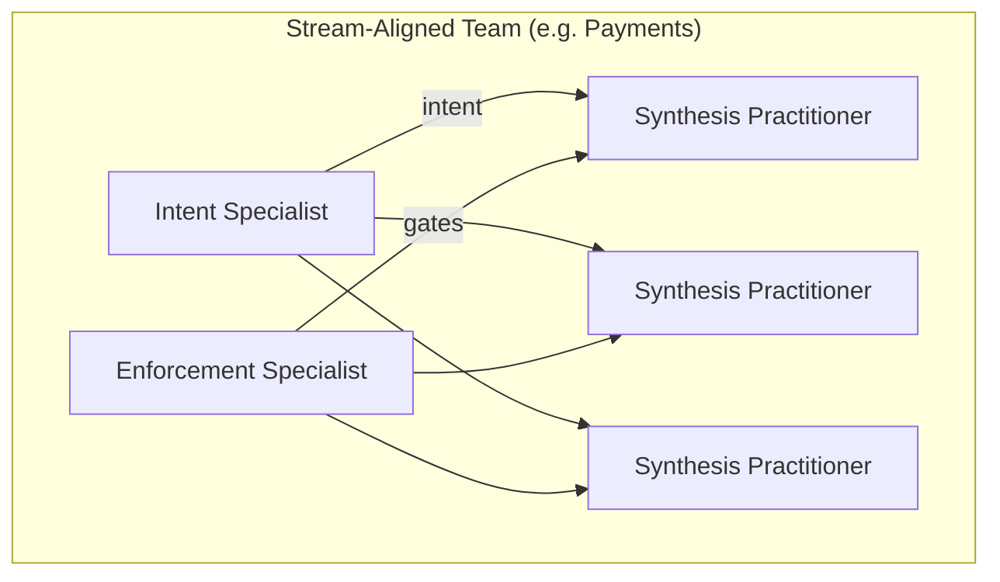
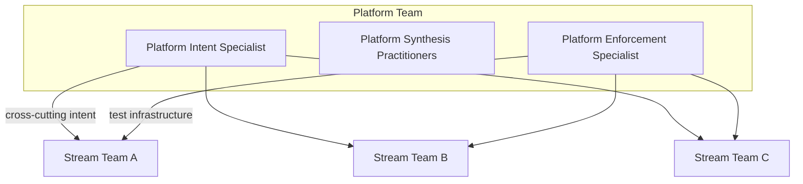
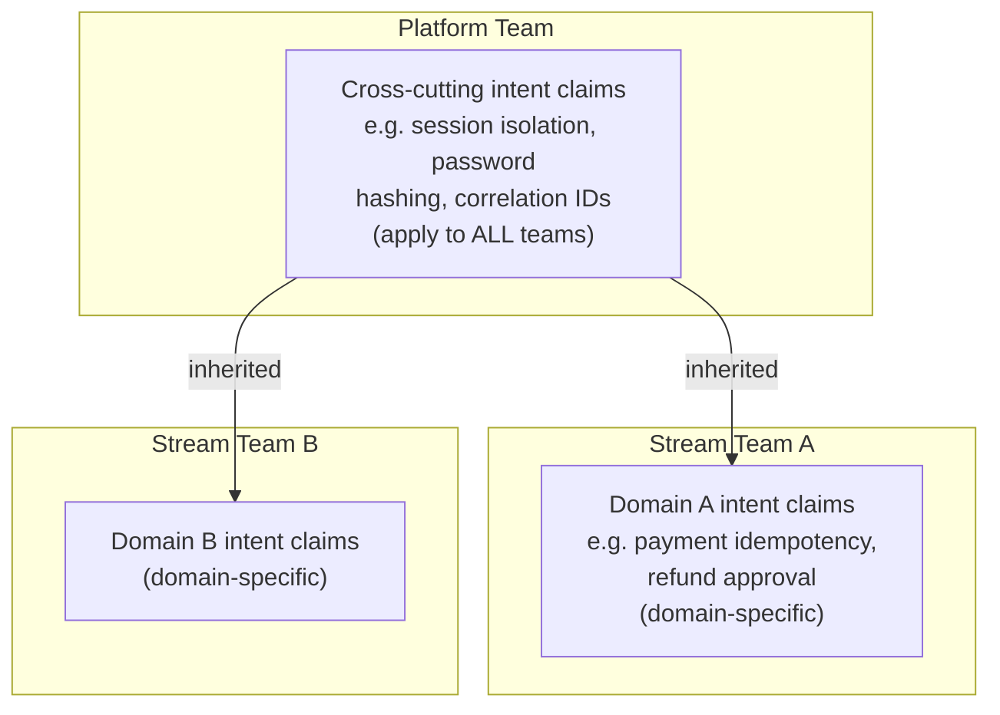
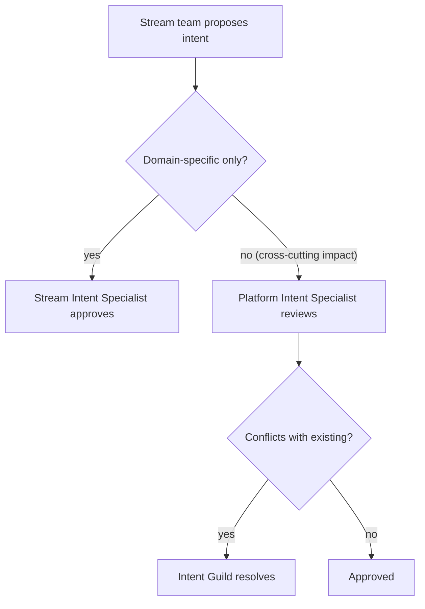

## Navigation

- **Parent**: [Team Structures Overview](./00-OVERVIEW.md)

---

## 1. Overview

CSD team structures build on Team Topologies concepts, adapted for the separation of judgment and synthesis. Team members operate in CSD cognitive modes rather than holding fixed job titles.

---

## 2. CSD Team Types

### 2.1 Stream-Aligned Team (CSD Version)

A team aligned to a business domain, with members operating across all three CSD cognitive modes.



**Composition**:

- 1 Intent Specialist (domain expert, primarily Intent Mode)
- 2-5 Synthesis Practitioners (primarily Synthesis Mode)
- 1 Enforcement Specialist (may be shared, primarily Enforcement Mode)

**Owns**:

- Domain intent specifications
- Domain implementation
- Domain intent tests

### 2.2 Platform Team (CSD Version)

A team providing shared capabilities for synthesis and quality.



**Provides**:

- Cross-cutting intent (security, observability, performance)
- Shared test infrastructure
- AI tool management and guidance
- Intent test frameworks and templates

### 2.3 Enabling Team (CSD Version)

A temporary team helping others adopt CSD.

**Provides**:

- CSD training and coaching
- Intent writing workshops
- Synthesis practice guidance
- Enforcement Mode bootstrapping

**Duration**: Time-limited engagement with stream teams

---

## 3. Team Interactions

### 3.1 Interaction Modes

| Mode | When Used | Example |
|------|-----------|---------|
| **Collaboration** | Discovery, new domain | Platform + Stream defining new cross-cutting intent |
| **X-as-a-Service** | Stable interface | Platform providing test infrastructure |
| **Facilitation** | Capability building | Enabling team coaching Stream team |

### 3.2 Intent Flow Between Teams



---

## 4. Scaling Patterns

### 4.1 Small Organization (< 20 engineers)

```text
Single Stream Team
|- 1-2 Intent Specialists (cover all domains)
|- 5-15 Synthesis Practitioners
|- 1-2 Enforcement Specialists
`- No separate platform team
```

### 4.2 Medium Organization (20-100 engineers)

```text
Multiple Stream Teams + Platform Team
|- Stream Team A (Domain 1)
|  |- 1 Intent Specialist
|  |- 3-5 Synthesis Practitioners
|  `- Shared Enforcement Specialist
|- Stream Team B (Domain 2)
|  `- ...
|- Platform Team
|  |- 1 Cross-cutting Intent Specialist
|  |- 2-3 Platform Synthesis Practitioners
|  `- 1-2 Enforcement Specialists (infrastructure)
`- Enabling Team (temporary, as needed)
```

### 4.3 Large Organization (100+ engineers)

```text
Multiple Stream Teams + Multiple Platform Teams
|- Stream Teams (10-15 per business area)
|- Platform Teams
|  |- Security Platform
|  |- Observability Platform
|  |- Data Platform
|  `- Developer Experience Platform
|- Intent Governance Team (cross-cutting)
|  `- Senior Intent Specialists from each domain
`- Enabling Teams (rotational)
```

---

## 5. Intent Governance

### 5.1 Cross-Team Intent Coordination

For large organizations, a lightweight governance structure:

| Body | Composition | Responsibility |
|------|-------------|----------------|
| **Intent Guild** | Intent Mode practitioners from all teams | Share patterns, resolve conflicts |
| **Enforcement Guild** | Enforcement Mode practitioners from all teams | Share infrastructure, tooling |
| **Synthesis Guild** | Senior Synthesis Mode practitioners | Share AI patterns, tooling |

### 5.2 Intent Review Process



---

## 6. Communication Patterns

### 6.1 Regular Ceremonies

| Ceremony | Participants | Frequency | Purpose |
|----------|--------------|-----------|---------|
| Intent Review | Stream team | Weekly | Review new/changed intents |
| Enforcement Standup | Enforcement Mode practitioners | Daily | Infrastructure health |
| Cross-Team Sync | Intent Mode practitioners | Bi-weekly | Alignment |
| Synthesis Retrospective | Synthesis Mode practitioners | Sprint | AI tool effectiveness |

### 6.2 Escalation Paths

```text
Synthesis Mode Practitioner
    |
    v (Intent unclear)
Intent Mode Practitioner
    |
    v (Cross-team conflict)
Intent Guild
    |
    v (Business impact)
Product Leadership
```

---

## 7. Conway's Law Alignment

CSD explicitly leverages Conway's Law:

> "Organizations design systems that mirror their communication structure."

### 7.1 System-Team Alignment

| System Boundary | Team Boundary |
|-----------------|---------------|
| Domain A (e.g., Payments) | Stream Team A |
| Domain B (e.g., Inventory) | Stream Team B |
| Cross-cutting (Security) | Platform Team |
| Infrastructure | Platform Team |

### 7.2 Intent Boundary = Team Boundary

- Stream teams own domain intent
- Platform teams own cross-cutting intent
- No team owns intent they don't implement

---

## 8. Anti-Patterns

### 8.1 Team Topology Anti-Patterns

| Anti-Pattern | Problem | Solution |
|--------------|---------|----------|
| Intent by Committee | No clear ownership | One Intent Mode practitioner per domain |
| Siloed Enforcement | Inconsistent enforcement | Shared Enforcement Mode specialists |
| Platform Bottleneck | Platform blocks stream teams | X-as-a-Service model |
| Too Many Intent Specialists | Conflict, inconsistency | Minimum viable ownership |
| No Cross-Team Intent | Drift across teams | Platform-owned cross-cutting intent |

---

## 9. Transition Patterns

### 9.1 From Existing Teams

```text
Current State
|- Feature Teams (traditional)
`- QA Team (separate)

Transition
|- Feature Team -> Stream Team
|  |- Tech Lead -> Intent Mode Specialist
|  |- Developers -> Synthesis Mode Practitioners
|  `- Embedded QA -> Enforcement Mode Specialist (shared)
`- QA Team -> Distributed Enforcement Specialists + Platform

Target State
|- Stream Teams (self-sufficient)
`- Platform Team (enabling)
```

### 9.2 Phased Approach

| Phase | Duration | Focus |
|-------|----------|-------|
| 1. Pilot | 1-2 sprints | Single team adopts CSD |
| 2. Expand | 2-3 sprints | Adjacent teams adopt |
| 3. Platform | 1-2 sprints | Formalize platform team |
| 4. Scale | Ongoing | All teams on CSD |

---

## Change Log

| Version | Date | Author | Changes |
|---------|------|--------|---------|
| 1.1.0 | 2026-07-04 | CSD Team | Topology and review diagrams in Mermaid |
| 1.0.0 | 2026-07-04 | CSD Team | Canonical mode terminology throughout, including diagrams; promoted to Active |
| 0.1.0 | 2026-02-04 | CSD Team | Initial team topologies |
