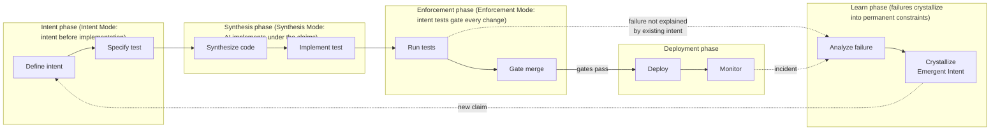
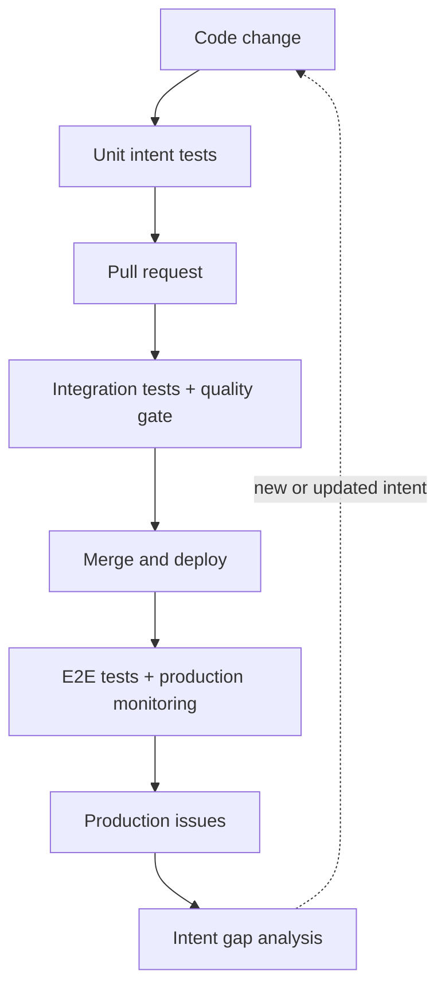

## Navigation

- **Parent**: [CSD Overview](../00-OVERVIEW.md)
- **Children**:
  - [Intent-First Development](./01-INTENT-FIRST.md)
  - [Synthesis Workflow](./02-SYNTHESIS-WORKFLOW.md)
  - [Continuous Enforcement](./03-CONTINUOUS-ENFORCEMENT.md)
  - [Learning Loop](./04-LEARNING-LOOP.md)

---

## 1. Introduction

The CSD loop is the shape intent-governed synthesis takes **inside whichever delivery lifecycle runs it** - CSD is a quality discipline, not a replacement lifecycle, so a host SDLC's phases keep their names and their order. Where a traditional model binds quality late (Plan -> Design -> Implement -> Test -> Deploy binds at Test), the work each phase hands to synthesis runs:

```text
Intent -> Synthesize -> Enforce -> Learn -> Deploy
```

The key differences:

- **Intent comes first**, and enforcement is continuous
- **Emergent Intent** feeds back from enforcement failures into new intent
- **TtTO** measures the health of each phase transition

---

## 2. Traditional vs. CSD Lifecycle

### 2.1 Traditional SDLC

```text
Plan -> Design -> Implement -> Test -> Deploy -> Maintain
^                               |
`----------- Defects found -----'
```

Problems:

- Testing happens after implementation
- Quality is a phase, not a property
- Decisions are implicit until defects reveal them

### 2.2 CSD Lifecycle



---

## 3. Lifecycle Phases

### 3.1 Intent Phase

| Activity | Who | Output |
|----------|-----|--------|
| Identify correctness criteria | Intent Mode practitioner | Draft statements |
| Write intent specifications | Intent Mode practitioner | Intent spec files |
| Define test requirements | Intent Mode practitioner | Test scope, component |
| Review and approve | Intent Mode practitioner + Team | Active intents |

**Entry Criteria**: Requirement or decision exists - OR - synthesis failure reveals missing intent (Emergent Intent)
**Exit Criteria**: Intent spec approved and active

### 3.2 Synthesis Phase

| Activity | Who | Output |
|----------|-----|--------|
| Read intent specification | Synthesis Mode practitioner | Understanding |
| Design approach | Synthesis Mode practitioner | Implementation plan |
| Guide AI synthesis | Synthesis Mode practitioner | Generated code |
| Review and refine | Synthesis Mode practitioner | Production-ready code |
| Write intent tests | Synthesis Mode practitioner | Test implementations |

**Entry Criteria**: Active intent specification exists
**Exit Criteria**: Code + tests ready for review

### 3.3 Enforcement Phase

| Activity | Who | Output |
|----------|-----|--------|
| Run intent tests | CI/CD (automated) | Pass/fail results |
| Run static analysis | CI/CD (automated) | Quality metrics |
| Gate merge | CI/CD (automated) | Merge allowed/blocked |
| Report failures | Enforcement Mode practitioner | Failure diagnosis |

**Entry Criteria**: Pull request submitted
**Exit Criteria**: All gates pass, merged to main

### 3.4 Learn Phase

| Activity | Who | Output |
|----------|-----|--------|
| Classify the failure | Enforcement Mode practitioner | Category (regression, missing intent, ambiguous intent, test gap, false positive) |
| Identify the intent gap | Intent Mode practitioner | Missing-constraint statement |
| Draft Emergent Intent | Intent Mode practitioner (AI-assisted) | Draft claim |
| Bind to test | Synthesis Mode practitioner | Attesting test |

**Entry Criteria**: An enforcement failure, incident, or review catch that existing intent does not explain
**Exit Criteria**: Failure classified; when a constraint was missing, the new claim is active with a passing test

See [Learning Loop](./04-LEARNING-LOOP.md) for the full mechanism.

### 3.5 Deployment Phase

| Activity | Who | Output |
|----------|-----|--------|
| Deploy to staging | CI/CD (automated) | Staging environment |
| Run E2E tests | CI/CD (automated) | End-to-end validation |
| Deploy to production | CI/CD (automated) | Production release |
| Monitor | Enforcement Mode practitioner | Health metrics |

**Entry Criteria**: Merged to main
**Exit Criteria**: Successful production deployment

---

## 4. The Intent-First Principle

### 4.1 What It Means

Before any code is written (human or AI), intent must be defined:

```text
Traditional:  Requirement -> Code -> Test -> Fix -> Ship
CSD:          Requirement -> Intent -> Test Spec -> Code -> Enforce -> Ship
```

### 4.2 Why It Matters

| Aspect | Without Intent-First | With Intent-First |
|--------|----------------------|-------------------|
| AI guidance | AI guesses at correctness | AI has explicit criteria |
| Test purpose | Tests verify implementation | Tests enforce intent |
| Refactoring | Risky, may break behavior | Safe if intent tests pass |
| Knowledge | Implicit, in people's heads | Explicit, in specifications |

---

## 5. Continuous Enforcement

### 5.1 Traditional Quality Gates

```text
Code -------------------------------------------> Ship
                     ^
                     |
                   Gate (end)
```

Problems: Quality checked late, expensive to fix

### 5.2 CSD Continuous Enforcement

```text
Code -> commit -> commit -> commit -> commit -> Ship
     ^         ^         ^         ^
     |         |         |         |
     gates at every commit
```

Benefits: Violations caught immediately, cheap to fix

---

## 6. Feedback Loops

Four nested loops return signal to the developer, each slower and wider than the last; the outermost closes back into the intent layer:



| Loop | Signal | Latency budget |
|------|--------|----------------|
| Fast | Unit intent tests on every change | < 2 minutes |
| Medium | Integration tests + quality gate on every PR | < 15 minutes |
| Slow | E2E tests on deploy, then monitoring | < 1 hour, then ongoing |
| Learning | Intent gap analysis from production issues | Sprint cycle |

---

## 7. Lifecycle Activities by Cognitive Mode

### 7.1 Intent Mode Activities

| Phase | Activities |
|-------|------------|
| Intent | Write specs, define test requirements, approve |
| Synthesis | Answer questions, clarify ambiguity |
| Enforcement | Review systematic failures |
| Learn | Approve crystallized Emergent Intent |
| Deployment | Validate business outcomes |

### 7.2 Synthesis Mode Activities

| Phase | Activities |
|-------|------------|
| Intent | Read specs, ask questions |
| Synthesis | Guide AI, write code, write tests |
| Enforcement | Fix failures, address review |
| Learn | Bind new Emergent Intent to tests |
| Deployment | Monitor, hotfix if needed |

### 7.3 Enforcement Mode Activities

| Phase | Activities |
|-------|------------|
| Intent | Ensure test infrastructure ready |
| Synthesis | Support test writing |
| Enforcement | Maintain gates, triage failures |
| Learn | Classify failures, surface patterns |
| Deployment | Monitor quality metrics |

---

## 8. Lifecycle Metrics

| Metric | Target | Phase |
|--------|--------|-------|
| Intent spec to implementation start | < 1 day | Intent  ->  Synthesis |
| Synthesis to PR | < 1-3 days | Synthesis |
| PR to merge | < 1 day | Enforcement |
| Failure to new active intent | < 1 sprint | Learn |
| Merge to production | < 1 day | Deployment |
| Intent test pass rate | 100% | All |
| Cycle time (intent to production) | < 1 week | End-to-end |

---

## 9. Comparison with Other Methodologies

| Aspect | Waterfall | Agile | DevOps | CSD |
|--------|-----------|-------|--------|-----|
| **When intent defined** | Requirements phase | Stories | Implicit | First, always |
| **When tested** | After impl | During sprint | Continuously | Continuously |
| **What gates deployment** | Manual approval | Done criteria | Passing tests | Intent tests |
| **Who owns correctness** | QA | Team | Team | Intent Mode practitioner |
| **AI role** | N/A | Tool | Tool | Core to process |

---

## 10. Getting Started

1. Read [Intent-First Development](./01-INTENT-FIRST.md)
2. Understand [Synthesis Workflow](./02-SYNTHESIS-WORKFLOW.md)
3. Set up [Continuous Enforcement](./03-CONTINUOUS-ENFORCEMENT.md)
4. Close the loop with the [Learning Loop](./04-LEARNING-LOOP.md)

---

## Change Log

| Version | Date | Author | Changes |
|---------|------|--------|---------|
| 1.1.0 | 2026-07-04 | CSD Team | Lifecycle and feedback loops in Mermaid |
| 1.0.0 | 2026-07-04 | CSD Team | Learn phase in the diagram, phase details, mode activities, and metrics; promoted to Active |
| 0.1.0 | 2026-02-04 | CSD Team | Initial lifecycle overview |
