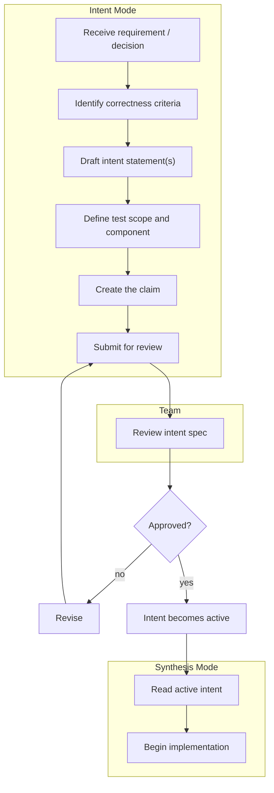

## Navigation

- **Parent**: [Lifecycle Overview](./00-OVERVIEW.md)

---

## 1. Overview

Intent-First Development is the foundational practice of CSD: **define what must be true before writing any code**.

> If you can't state the intent, you shouldn't start the implementation.

---

## 2. The Intent-First Workflow



---

## 3. Why Intent First?

### 3.1 For Human-Written Code

| Without Intent | With Intent |
|----------------|-------------|
| Developer interprets requirements | Intent explicitly states correctness |
| "Done" is subjective | "Done" = intent tests pass |
| Refactoring is risky | Refactoring is safe if tests pass |
| Knowledge in people's heads | Knowledge in specifications |

### 3.2 For AI-Generated Code

| Without Intent | With Intent |
|----------------|-------------|
| AI guesses at correctness | AI has explicit criteria |
| Review is subjective | Review checks intent compliance |
| Drift is undetectable | Drift fails intent tests |
| No binding constraints | Tests bind synthesis |

---

## 4. The Intent-First Checklist

Before starting any implementation:

- [ ] **Intent exists**: Active intent specification covers the work
- [ ] **Intent is testable**: Test scope and component defined
- [ ] **Intent is clear**: No ambiguity in the statement
- [ ] **Intent is minimal**: Covers correctness, not implementation details
- [ ] **Intent owner available**: Intent Mode practitioner can answer questions during synthesis

---

## 5. Deriving Intent from Sources

### 5.1 From Requirements

```text
Requirement: "Users must be able to reset their password"

Derived Intents:
- INT-101: "Password reset tokens must expire within 1 hour"
- INT-102: "Password reset must invalidate all active sessions"
- INT-103: "Password reset email must not reveal if account exists"
```

### 5.2 From Decisions

```text
Decision: "Use event sourcing for order management"

Derived Intents:
- INT-201: "Order state must be reconstructable from events"
- INT-202: "Events must be immutable after persistence"
- INT-203: "Event sequence must be monotonically increasing"
```

### 5.3 From Incidents

```text
Incident: "Race condition caused double charging"

Derived Intents:
- INT-301: "Payment processing must be idempotent for same request ID"
- INT-302: "Concurrent payment requests must be serialized per user"
```

### 5.4 From Regulations

```text
Regulation: "GDPR data portability"

Derived Intents:
- INT-401: "User data export must include all personal data"
- INT-402: "Export format must be machine-readable (JSON/CSV)"
- INT-403: "Export must complete within 30 days of request"
```

---

## 6. When Intent Already Exists

If working on a feature covered by existing intent:

1. **Find relevant intents**: Search by domain, component, or keyword
2. **Verify applicability**: Ensure intent covers your change
3. **Check test coverage**: Confirm intent test exists and passes
4. **Proceed with synthesis**: Intent guides implementation

```text
Feature: Add new payment method

1. Search: "payment" -> INT-050 through INT-059
2. Relevant: INT-050 (payment idempotency), INT-055 (payment audit)
3. Check: Both have passing tests
4. Proceed: Implementation must satisfy both intents
```

---

## 7. When Intent Is Missing

If no intent covers the work:

1. **Pause implementation**: Don't start without intent
2. **Draft intent**: Work with Intent Mode practitioner
3. **Get approval**: Intent must be active before coding
4. **Then proceed**: Implementation guided by new intent

```text
Feature: Add cryptocurrency payment

1. Search: No intent for crypto
2. Need: New intent for crypto-specific correctness
3. Draft with Intent Mode practitioner:
   - INT-060: "Cryptocurrency payments must verify blockchain confirmation"
   - INT-061: "Exchange rate must be locked at payment initiation"
4. Approval: Intent Mode practitioner reviews and activates
5. Proceed: Implementation satisfies new intents
```

---

## 8. Intent Specification Ceremony

For significant features, hold an Intent Specification session:

### 8.1 Participants

- Intent Mode practitioner (leads)
- Synthesis Mode practitioners (input)
- Enforcement Mode practitioner (feasibility)
- Stakeholder (optional, for context)

### 8.2 Agenda (1-2 hours)

1. **Context** (10 min): What are we building? Why?
2. **Brainstorm** (20 min): What must be true for correctness?
3. **Refine** (30 min): Convert to testable statements
4. **Specify** (30 min): Define scope, component, criticality
5. **Review** (15 min): Final check, assign owners

### 8.3 Output

- Draft intent specifications
- Test scope decisions
- Open questions for follow-up

---

## 9. Intent-First Anti-Patterns

### 9.1 What to Avoid

| Anti-Pattern | Problem | Solution |
|--------------|---------|----------|
| "We'll add intent later" | Implementation diverges | No code without intent |
| Intent written by developer | Bias toward implementation | Intent Mode practitioner writes intent |
| Intent matches code | Circular reasoning | Intent precedes code |
| Too many intents upfront | Paralysis | Start minimal, add as needed |
| Vague intent | Untestable | Iterate until specific |

---

## 10. Examples

### 10.1 Good Intent-First Flow

```text
1. Requirement: "Support multi-factor authentication"

2. Intent Specification Session:
   - INT-070: "MFA must be required for sensitive operations"
   - INT-071: "MFA tokens must expire within 5 minutes"
   - INT-072: "Failed MFA attempts must be rate-limited"

3. Intent Review: Approved

4. Implementation: 
   - Synthesis Mode practitioner reads INT-070, INT-071, INT-072
   - AI generates code constrained by intents
   - Intent tests written
   - All tests pass

5. Merge: Safe, intent verified
```

### 10.2 Bad Flow (Intent After)

```text
1. Requirement: "Support multi-factor authentication"

2. Implementation:
   - Developer writes code
   - "Works on my machine"
   - No clear correctness criteria

3. Later:
   - Bug found: MFA tokens don't expire
   - Incident: Rate limiting missing
   - Intent written retroactively to match buggy code

4. Result: Intent is meaningless
```

---

## Change Log

| Version | Date | Author | Changes |
|---------|------|--------|---------|
| 1.1.0 | 2026-07-04 | CSD Team | Intent-first workflow in Mermaid |
| 1.0.0 | 2026-07-04 | CSD Team | Reviewed against practice; promoted to Active |
| 0.1.0 | 2026-02-04 | CSD Team | Initial intent-first guide |
