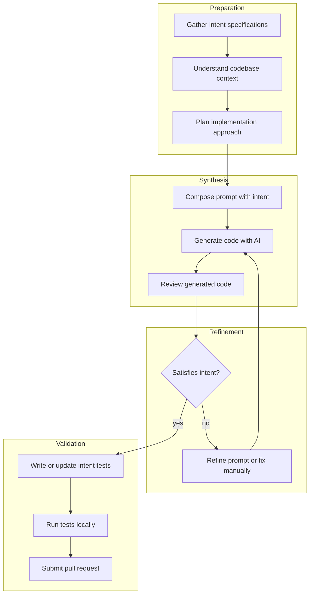

## Navigation

- **Parent**: [Lifecycle Overview](./00-OVERVIEW.md)

---

## 1. Overview

The Synthesis Workflow defines how practitioners in Synthesis Mode guide AI-assisted implementation while ensuring intent compliance.

---

## 2. Synthesis Workflow Phases



---

## 3. Phase 1: Preparation

### 3.1 Gather Context

Before prompting AI:

```text
1. Read intent specification(s)
   - What must be true?
   - What scope? What component?
   
2. Review existing code
   - What patterns are used?
   - What conventions exist?
   
3. Check related intents
   - What else applies to this area?
   
4. Note constraints
   - Technology choices
   - Performance requirements
   - Security considerations
```

### 3.2 Plan Approach

| Question | Answer Required |
|----------|-----------------|
| What components need changes? | List of files/classes |
| What's the implementation strategy? | Approach (e.g., "add method to existing service") |
| What dependencies needed? | New libraries, configurations |
| What tests needed? | Intent tests per specification |

---

## 4. Phase 2: Synthesis

### 4.1 Compose Effective Prompts

Prompts follow the intent-bound contract defined in [Synthesis Mode](../03-TEAMS/02-SYNTHESIS-MODE.md): they name the **context**, quote the relevant **claims verbatim**, state the **task**, and list the **constraints**. An illustrative minimal shape:

```text
Context:     the component, the system, the conventions in play
Intent:      the claim(s), quoted verbatim from intent.yaml
Task:        the specific deliverable
Constraints: testability, patterns to follow, boundaries not to cross
```

### 4.2 Iterate Synthesis

```text
Prompt -> Generate -> Review -> Refine -> Repeat
        |
    [Is output correct?]
        |
    No: Adjust prompt, add context
    Yes: Proceed to validation
```

### 4.3 Know When to Stop AI

Use manual coding when:

- AI fails 3+ times on same issue
- Security-critical crypto code
- Highly domain-specific logic
- Faster to type than prompt

---

## 5. Phase 3: Refinement

### 5.1 Review Generated Code

Checklist for AI-generated code:

- [ ] **Correctness**: Does it implement the intent?
- [ ] **Completeness**: All edge cases handled?
- [ ] **Consistency**: Matches codebase patterns?
- [ ] **Security**: No vulnerabilities introduced?
- [ ] **Performance**: No obvious inefficiencies?
- [ ] **Testability**: Can write intent test against it?

### 5.2 Common AI Issues and Fixes

| Issue | AI Tendency | Fix |
|-------|-------------|-----|
| Missing error handling | Optimistic path only | Explicitly request error cases |
| Inconsistent naming | Generic names | Provide naming examples |
| Over-engineering | Complex solutions | Request minimal implementation |
| Wrong patterns | Generic patterns | Reference existing code |
| Security gaps | No security thinking | Include security in prompt |

---

## 6. Phase 4: Validation

### 6.1 Write Intent Tests

For each intent, a test carrying its marker at the declared scope:

```typescript
intent('INT-001', 'session data never crosses user boundaries', () => {
    /* arrange a session for user A; assert user B cannot access it */
});
```

### 6.2 Run Tests Locally

Before submitting, run the intent tests at the affected scopes and the coverage audit, so the pull request arrives with every touched claim attested and passing.

### 6.3 Submit Pull Request

PR checklist:

- [ ] Intent specification referenced
- [ ] Intent test(s) included
- [ ] All tests pass locally
- [ ] Code follows patterns
- [ ] No security issues

---

## 7. Synthesis Patterns

### 7.1 Pattern: New Component

```text
1. Identify intents for component
2. Generate interface first (AI)
3. Generate implementation (AI)
4. Generate intent test (AI + human refinement)
5. Integrate with existing code (human)
6. Verify end-to-end (tests)
```

### 7.2 Pattern: Modify Existing

```text
1. Read existing code
2. Identify affected intents
3. Make targeted changes (AI + human)
4. Verify existing tests still pass
5. Add new intent tests if needed
6. Submit
```

### 7.3 Pattern: Refactoring

```text
1. Identify all intents for area
2. Ensure intent tests exist and pass
3. Refactor (AI + human)
4. Verify intent tests still pass
5. No changes to intent specs (unless intentional)
6. Submit
```

---

## 8. Prompt Library

Teams SHOULD maintain a library of reusable prompts for their recurring task shapes. Every entry obeys the intent-bound contract (Section 4.1); what varies per entry is the task shape and its default constraints:

| Task shape | Intent element carries | Typical extra constraints |
|------------|------------------------|---------------------------|
| New component | The claims the component must satisfy | Follow existing patterns; testable in isolation |
| Intent test | The claim being attested, verbatim | Positive and negative cases; property-based for invariants |
| Bug fix | The claim the bug violates, and why | Minimal change; include a regression test |

The library is tooling practice, not methodology: its value is measured by first-pass compliance (Section 9), and entries that keep failing intent tests get refined or retired.

---

## 9. Synthesis Metrics

| Metric | Target | Indicates |
|--------|--------|-----------|
| First-pass AI success | > 70% | Effective prompting |
| AI iteration cycles | < 3 | Good context provision |
| Manual intervention rate | < 30% | AI suitability |
| Intent test pass rate | 100% | Correct synthesis |
| Time to synthesis | Decreasing | Learning curve |

---

## 10. Anti-Patterns

| Anti-Pattern | Problem | Solution |
|--------------|---------|----------|
| Blind acceptance | Trust AI without review | Always critically evaluate |
| No intent reference | AI lacks constraints | Always include intent in prompt |
| Over-prompting | Diminishing returns | Know when to code manually |
| Skipping tests | No validation | Tests are mandatory |
| Copy-paste synthesis | No understanding | Understand before accepting |

---

## Change Log

| Version | Date | Author | Changes |
|---------|------|--------|---------|
| 1.1.0 | 2026-07-04 | CSD Team | Workflow phases in Mermaid; prompting and the prompt library stated as contracts, not literal prompt texts |
| 1.0.0 | 2026-07-04 | CSD Team | Canonical mode terminology; validation stated via markers and the audit; promoted to Active |
| 0.1.0 | 2026-02-04 | CSD Team | Initial synthesis workflow |
