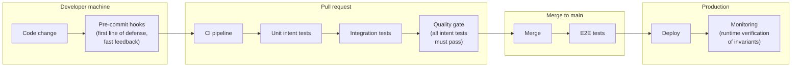
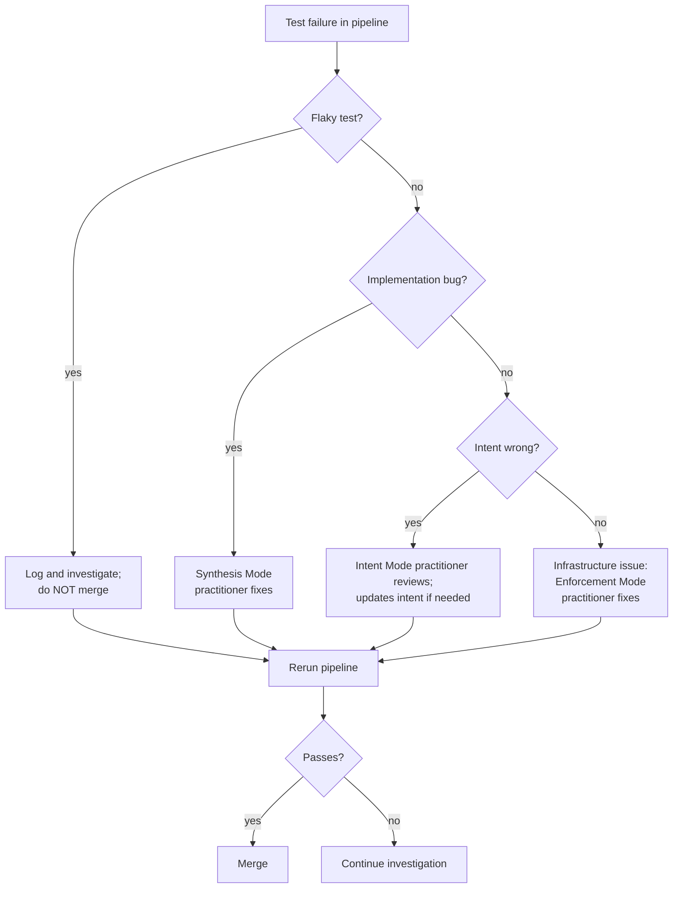

## Navigation

- **Parent**: [Lifecycle Overview](./00-OVERVIEW.md)

---

## 1. Overview

Continuous Enforcement ensures that intent constraints are verified at every point in the delivery pipeline, making violations impossible to deploy.

> **Principle**: If it's not tested, it's not enforced. If it's not enforced, it's optional.

---

## 2. Enforcement Points

---

## 3. Pre-Commit Enforcement

### 3.1 What Runs

Only fast checks run before a commit: intent schema validation on changed claims and lint on changed intent tests. The point is feedback in seconds, so violations die on the developer's machine instead of in CI.

### 3.2 What Doesn't Run

- Full test suites (too slow)
- Integration tests (need infrastructure)
- E2E tests (need full environment)

---

## 4. CI Pipeline Enforcement

### 4.1 Pipeline Structure

The CI pipeline runs on every pull request and every push to the main branch, staged from fast to slow so cheap failures short-circuit expensive stages:

1. **Unit intent tests** run first, within their suite budget.
2. **Integration intent tests** run only after unit tests pass, against real dependencies.
3. **Quality gate** runs last: the coverage audit (no unattested active claims, no orphan markers) plus static analysis.

Every stage blocks the next; no stage tolerates failure.

### 4.2 Gate Criteria

| Gate | Criteria | Failure Action |
|------|----------|----------------|
| Unit Intent Tests | 100% pass | Block merge |
| Integration Intent Tests | 100% pass | Block merge |
| Intent Coverage | 100% critical intents | Block merge |
| Static Analysis | No critical issues | Block merge |

---

## 5. Merge Enforcement

### 5.1 Branch Protection

The main branch enforces:

- All pipeline stages (unit, integration, quality gate) pass on the merged result, not a stale base
- At least one approving human review
- No administrator bypass: the rules bind everyone, including those who can change the rules

### 5.2 No Exceptions

| Request | Response |
|---------|----------|
| "Skip tests for this urgent fix" | No. Fix the test or intent. |
| "Override for deadline" | No. Deadline doesn't change correctness. |
| "Tests are flaky, let me merge" | No. Fix flaky tests first. |
| "Intent is wrong, let me merge anyway" | No. Fix intent, then merge. |

---

## 6. Post-Merge Enforcement

### 6.1 E2E Tests on Main

Every merge to main deploys to a staging environment and runs the e2e intent tests against it. A failure rolls staging back and blocks promotion; main is never allowed to drift ahead of what e2e has verified.

### 6.2 Production Deployment Gate

Production deployment requires the e2e stage to have passed, and is followed immediately by smoke tests against the live system. A failed smoke test triggers rollback, not investigation-in-place.

---

## 7. Runtime Enforcement

### 7.1 Production Monitoring

Critical invariants can be enforced a second time at runtime: the guarding code path checks the invariant on every call, refuses the operation when it fails, and emits a violation metric tagged with the claim ID. Tests prove the invariant held at build time; the runtime check catches what tests cannot foresee.

### 7.2 Alerting on Violations

Any nonzero intent-violation metric alerts at critical severity, on the highest-urgency channel, with a runbook attached. A runtime intent violation is never noise: it means a claim marked critical failed in production.

---

## 8. Enforcement Metrics

### 8.1 Key Metrics

| Metric | Target | Why |
|--------|--------|-----|
| Pipeline pass rate | > 95% | High quality submissions |
| Intent test pass rate | 100% | Enforcement working |
| Mean time to green | < 30 min | Fast feedback |
| Blocked merges per week | Decreasing | Learning curve |
| Runtime violations | 0 | Production safety |

### 8.2 Dashboard

The enforcement dashboard shows, at a glance: current pipeline status, today's run count with pass/fail breakdown and the failing claims named, the trailing-week intent test pass rate, and the trailing-week runtime violation count. All of it is generated from pipeline and monitoring data.

---

## 9. Handling Enforcement Failures

### 9.1 Triage Flow

### 9.2 Escalation Path

| Failure Type | First Responder | Escalation |
|--------------|-----------------|------------|
| Unit test failure | Synthesis Mode practitioner | Intent Mode practitioner |
| Integration test failure | Synthesis Mode practitioner | Enforcement Mode practitioner |
| Infrastructure failure | Enforcement Mode practitioner | Platform Team |
| Flaky test | Enforcement Mode practitioner | Team lead |
| Intent unclear | Synthesis Mode practitioner | Intent Mode practitioner |

---

## 10. Continuous Improvement

### 10.1 Weekly Review

- Review all blocked merges
- Identify patterns in failures
- Update intents if systematically wrong
- Improve test infrastructure if flaky
- Share learnings with team

### 10.2 Metrics Review

- Track pass rate trends
- Identify slow tests
- Monitor coverage gaps
- Celebrate improvements

---

## Change Log

| Version | Date | Author | Changes |
|---------|------|--------|---------|
| 1.1.0 | 2026-07-04 | CSD Team | Enforcement points and failure triage in Mermaid |
| 1.0.0 | 2026-07-04 | CSD Team | Enforcement points stated as criteria and rules, not pipeline configuration; promoted to Active |
| 0.1.0 | 2026-02-04 | CSD Team | Initial continuous enforcement guide |
