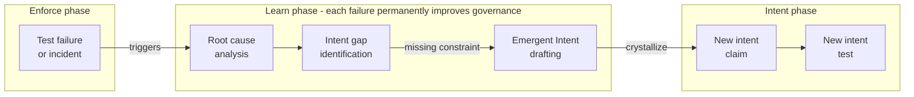

## Navigation

- **Parent**: [Delivery Lifecycle Overview](./00-OVERVIEW.md)

---

## 1. Overview

The **Learn** phase is the fourth phase of the CSD lifecycle. It turns enforcement failures into permanent governance improvements through Emergent Intent.

> "Every failure that teaches is a constraint that was missing. The Learn phase captures it."

```text
Intent -> Synthesize -> Enforce -> **Learn** -> Deploy
```

---

## 2. Purpose

Traditional delivery treats failures as bugs to fix. CSD treats failures as **missing constraints to capture**. The Learn phase closes the loop: enforcement failures feed back into the intent layer, permanently improving governance.

| Traditional | CSD Learn Phase |
|-------------|-----------------|
| Fix the bug, move on | Ask: "What intent was missing?" |
| Post-mortem as documentation | Post-mortem as new intent spec |
| Lessons learned (forgotten) | Lessons crystallized as executable tests |
| Repeated similar failures | Each failure type caught permanently |

---

## 3. The Learning Loop



---

## 4. Activities

### 4.1 Failure Classification

When enforcement catches a problem (test failure, incident, drift detection), classify it:

| Category | Action | Example |
|----------|--------|---------|
| **Known intent violated** | Fix implementation | INT-001 test failed due to regression |
| **Missing intent** | Draft Emergent Intent | Security boundary crossed, no intent existed |
| **Ambiguous intent** | Clarify existing intent | Intent statement was interpreted two ways |
| **Test gap** | Add test, keep intent | Intent existed but no test covered this path |
| **False positive** | Fix test | Test flagged correct behavior as failure |

### 4.2 Emergent Intent Capture

When a failure reveals a missing constraint:

1. **Document the failure** - What went wrong and why
2. **Identify the missing constraint** - What statement of truth would have prevented this
3. **Draft the intent spec** - Using the standard intent format
4. **Write the intent test** - Prove the constraint catches the failure
5. **Submit for review** - The new intent enters the normal lifecycle
6. **Verify the ratchet** - Confirm this class of failure is now permanently caught

### 4.3 Trust Ratchet Effect

Each captured Emergent Intent permanently improves the system's trust level:

```text
Failure -> Emergent Intent -> New Test -> Trust Level Increases
```

This is the **Trust Ratchet**: governance can only improve, never regress. See [Trust Calibration](../02-TESTING/05-TRUST-CALIBRATION.md).

---

## 5. When to Enter the Learn Phase

| Trigger | Learn Phase Action |
|---------|-------------------|
| Intent test fails on main branch | Investigate: implementation bug or missing intent? |
| Production incident | Post-mortem yields Emergent Intent candidates |
| Code review catches issue not tested | Why did enforcement miss this? |
| Drift detected | What constraint should have prevented drift? |
| Repeated similar failures | Identify the pattern, write the general intent |

---

## 6. Metrics

| Metric | What It Measures | Target |
|--------|-----------------|--------|
| Emergent Intents per sprint | Learning rate | Decreasing over time (system matures) |
| Time from failure to new intent | Learning speed | < 1 sprint |
| Repeat failure rate | Ratchet effectiveness | 0% (same failure never recurs) |
| Intent coverage delta | Governance growth | Positive each quarter |

---

## 7. Anti-Patterns

| Anti-Pattern | Problem | Solution |
|--------------|---------|----------|
| Fix and forget | Failure recurs because no intent was captured | Always ask: "What intent was missing?" |
| Over-learning | Creating intent for every trivial issue | Focus on correctness-critical failures |
| Blame-driven learning | Focusing on who, not what | Focus on missing constraints, not people |
| Stale post-mortems | Document but never crystallize | Every post-mortem must produce intent or explain why not |

---

## 8. Integration with Other Phases

| Phase | Interaction with Learn |
|-------|----------------------|
| **Intent** | Learn phase produces new intent specs (Emergent Intent) |
| **Synthesize** | Learn phase may reveal synthesis patterns that need guidance |
| **Enforce** | Learn phase improves enforcement by adding new tests |
| **Deploy** | Production incidents trigger Learn phase post-mortems |

---

## Change Log

| Version | Date | Author | Changes |
|---------|------|--------|---------|
| 1.1.0 | 2026-07-04 | CSD Team | Learning loop in Mermaid |
| 1.0.0 | 2026-07-04 | CSD Team | Reviewed against practice; promoted to Active |
| 0.1.0 | 2026-02-04 | CSD Team | Initial learning loop documentation |
