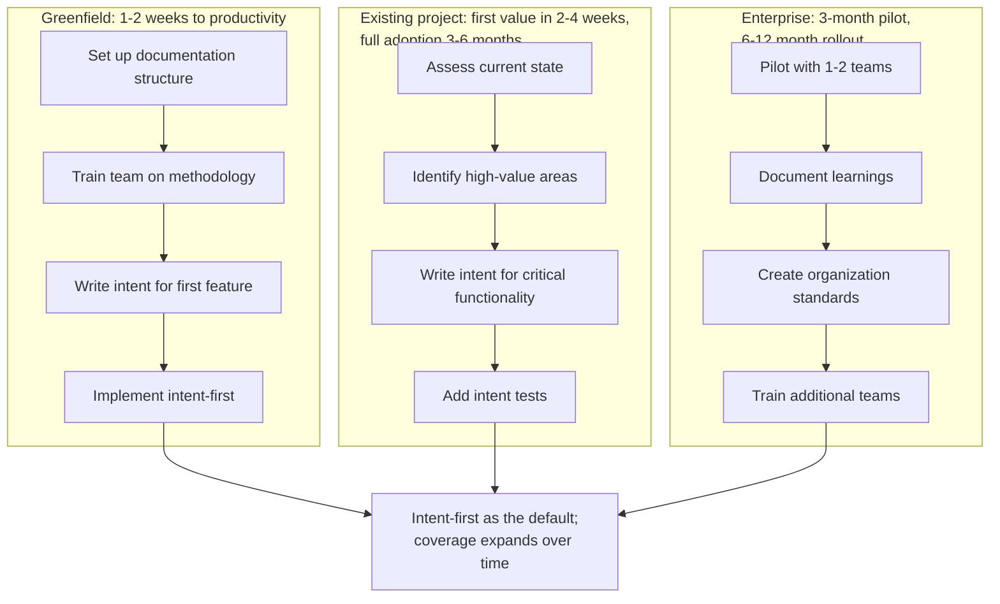

## Navigation

- **Parent**: [CSD Overview](../00-OVERVIEW.md)
- **Children**:
  - [Assessment Guide](./01-ASSESSMENT.md)
  - [Migration Paths](./02-MIGRATION-PATHS.md)
  - [Maturity Model](./03-MATURITY-MODEL.md)

---

## 1. Introduction

Adopting Cognitive Software Delivery is a journey, not a switch. This section provides guidance for teams transitioning from traditional methodologies to CSD.

---

## 2. Why Adopt CSD?

### 2.1 The AI Reality

AI code generation is here. Teams face a choice:

| Approach | Risk | Outcome |
|----------|------|---------|
| Ignore AI | Fall behind competitors | Technical debt, slower delivery |
| Adopt AI blindly | Quality erosion | Defects, security issues |
| Adopt CSD | Controlled AI leverage | Quality + speed |

The real danger is the middle column. Teams that adopt AI without intent-first guardrails experience a pattern we call **silent quality decay**: the code works, the demos succeed, the sprint velocity looks great - until a production incident reveals that nobody actually specified what "correct" meant. CSD exists to make correctness explicit before a single line of code is written or generated.

### 2.2 Benefits of CSD

| Benefit | Description |
|---------|-------------|
| **Explicit Correctness** | Intent specifications make "correct" objective |
| **Safe AI Use** | Tests constrain AI synthesis |
| **Knowledge Preservation** | Intent survives team changes |
| **Faster Onboarding** | New team members read intent, not just code |
| **Confident Refactoring** | Intent tests verify behavior preservation |

### 2.3 What CSD Is Not

Before adopting, understand what you are not signing up for:

- **Not a new Agile framework.** CSD is a quality methodology. It composes with Scrum, Kanban, SAFe, or no framework at all.
- **Not documentation-heavy.** An intent spec is typically 20-40 lines. If it takes longer to write the intent than to write the test, the intent is too detailed.
- **Not anti-human-coding.** CSD works identically whether code is written by a human, generated by AI, or a mix. The cognitive modes are thinking patterns, not tooling mandates.
- **Not all-or-nothing.** A single intent spec + a single test + CI enforcement = you are doing CSD. Start there.

---

## 3. Adoption Paths

Three starting points, one destination:

---

## 4. Getting Started

### 4.1 Minimum Viable CSD

Start with just these elements:

1. **One critical intent**: Identify your most critical correctness criteria
2. **One intent test**: Write a test that enforces it
3. **One enforcement point**: Make the test run in CI

That's it. You're doing CSD.

### 4.2 First Week Checklist

- [ ] Read [CSD Overview](../00-OVERVIEW.md)
- [ ] Identify Intent Mode practitioner for pilot area
- [ ] Write first intent specification
- [ ] Implement first intent test
- [ ] Set up CI enforcement
- [ ] Conduct first team review

### 4.3 First Month Goals

- [ ] 5+ active intent specifications
- [ ] All critical intents have tests
- [ ] Team understands cognitive modes
- [ ] Process documented for team
- [ ] Metrics tracking started

---

## 5. Anti-Patterns

These are the most common ways teams fail at CSD adoption. Recognizing them early prevents months of wasted effort.

### 5.1 Intent Theater

**Symptom:** Team writes intent specifications after the code is already written, treating them as documentation rather than design artifacts.

**Why it happens:** The team optimizes for appearing compliant rather than changing their workflow. Sprint pressure incentivizes "write the code first, backfill the intent."

**Fix:** Make intent review the first agenda item in sprint planning. If intent doesn't exist before coding starts, the work item is not ready.

### 5.2 Test Without Intent

**Symptom:** Team writes many tests but none trace back to an intent specification. Tests verify implementation details, not correctness criteria.

**Why it happens:** Developers are comfortable writing tests but uncomfortable thinking in terms of behavioral contracts. They default to testing "what the code does" rather than "what the code must guarantee."

**Fix:** Every test file should reference the intent ID it enforces. If a test cannot be traced to an intent, it is a unit test (fine to keep) but not an intent test. The distinction matters for coverage metrics.

### 5.3 Over-Specification

**Symptom:** Intent specifications describe implementation details: "must use a HashMap," "must call the validation service before the persistence service."

**Why it happens:** Engineers struggle to separate "what must be true" from "how it should work." This is the hardest mental shift in CSD.

**Fix:** Apply the rewrite test: if you could completely rewrite the implementation in a different language and the intent should still hold, the intent is at the right level. If it would break, the intent is too coupled to implementation.

### 5.4 Big Bang Adoption

**Symptom:** Team tries to write intent for their entire codebase before anyone has practiced writing a single intent spec.

**Why it happens:** Management wants to "do it right" and mandates full coverage. The team burns out writing intent specs they don't yet know how to write well.

**Fix:** Start with one critical area. Get good at intent-first development on a small scope. Expand only after the team has internalized the cognitive mode shifts.

### 5.5 Cognitive Mode Silos

**Symptom:** Intent Mode is permanently assigned to the tech lead; Synthesis Mode is "the developers"; Enforcement Mode is "QA." Nobody rotates.

**Why it happens:** It maps neatly onto existing org charts and feels efficient.

**Why it fails:** Cognitive modes are thinking patterns. If developers never practice Intent Mode, they cannot write good code against intent they don't understand. If QA never practices Synthesis Mode, enforcement becomes adversarial instead of collaborative.

**Fix:** Rotate mode responsibility. Have developers write intent for each other's areas. Have QA synthesize test harnesses. The goal is mode fluency, not mode ownership.

---

## 6. Resistance Patterns

Adoption resistance is normal. These are the specific objections teams raise and how to address them constructively.

### 6.1 "We Don't Have Time"

**Reality check:** Teams that say this are usually spending 30-40% of their time on rework, bug investigation, and "what was this supposed to do?" conversations. CSD front-loads 15 minutes of intent writing to eliminate hours of downstream confusion.

**Response:** Run a one-week experiment. Pick a single feature. Write intent first. Measure time-to-done including rework. Compare to the previous feature done without intent.

### 6.2 "Our Tests Already Cover This"

**Reality check:** Existing tests cover what the code does. Intent tests cover what the code must guarantee. These overlap but are not the same. A test that asserts `assertEquals(result, 42)` tells you the code returns 42. An intent test that asserts "discount calculation must never exceed the item price" tells you why 42 matters and catches the case where a future change makes it 43.

**Response:** Pick three critical bugs from the last quarter. For each, ask: "Would an intent specification have prevented this?" If even one answer is yes, the team has evidence that existing tests are not sufficient.

### 6.3 "This Is Just More Documentation"

**Reality check:** Intent specs are executable. They are not prose documents - they are paired with tests that run in CI. If an intent has no test, it is incomplete. If a test has no intent, it is untraceable. The documentation IS the test contract.

**Response:** Show the team an intent spec alongside its test. The spec is 20 lines. The test is 15 lines. Together they took 20 minutes to write and will prevent an entire class of defects permanently.

### 6.4 "AI Will Make This Obsolete"

**Reality check:** AI makes CSD more valuable, not less. The faster code is generated, the more critical it becomes to know what "correct" means. An AI can generate 500 lines of code in seconds. Without intent, who reviews those 500 lines? With intent, the test suite reviews them automatically.

**Response:** Generate a feature with AI. Then generate the same feature with the intent spec included in the prompt. Compare the output quality. The difference is usually dramatic and immediately visible.

---

## 7. Common Questions

### "Do we need all the cognitive modes?"

No. Start simple:

| Team Size | Modes |
|-----------|-------|
| Solo / 2 | One person switches between all modes |
| 3-5 | Rotate Intent Mode; all practice Synthesis Mode |
| 6+ | Dedicated mode specialists make sense |

### "Do we need all the documentation?"

No. Start with:

1. Intent specifications
2. Intent tests

Add documentation as you need it.

### "How do we prioritize what to write intent for?"

Priority order:

1. Security-critical functionality
2. Financial/data integrity
3. Core business logic
4. Everything else

### "What about our existing tests?"

Keep them. Then:

1. Identify which enforce intent (mark them)
2. Identify gaps (write new intent tests)
3. Over time, organize by intent

---

## 8. Documents in This Section

| Document | Purpose |
|----------|---------|
| [Assessment Guide](./01-ASSESSMENT.md) | Evaluate current state and readiness |
| [Migration Paths](./02-MIGRATION-PATHS.md) | Detailed adoption strategies |
| [Maturity Model](./03-MATURITY-MODEL.md) | Track adoption progress |

---

## Change Log

| Version | Date | Author | Changes |
|---------|------|--------|---------|
| 1.1.0 | 2026-07-04 | CSD Team | Adoption paths in Mermaid |
| 1.0.0 | 2026-07-04 | CSD Team | Reviewed against practice; promoted to Active |
| 0.2.0 | 2026-04-20 | CSD Team | Added anti-patterns, resistance patterns, "What CSD Is Not" |
| 0.1.0 | 2026-02-04 | CSD Team | Initial adoption overview |
