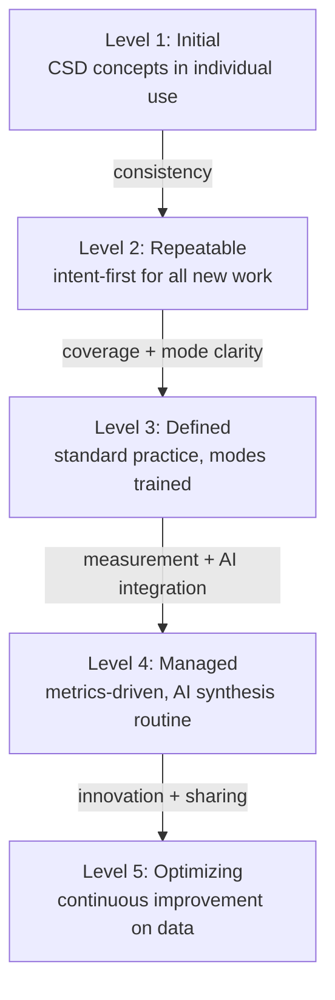

## Navigation

- **Parent**: [Adoption Overview](./00-OVERVIEW.md)

---

## 1. Overview

The CSD Maturity Model helps teams assess their adoption progress and identify improvement areas.

---

## 2. Maturity Levels



---

## 3. Level Definitions

### Level 1: Initial

> "We're starting to use CSD concepts"

**Characteristics:**

- Some intent specifications exist
- Testing is ad-hoc
- Process is not consistent
- Individual initiative

**Criteria:**

| Dimension | Criteria |
|-----------|----------|
| Intent | At least 1 intent specification exists |
| Testing | At least 1 intent test exists |
| Process | Team aware of CSD concepts |
| Tools | Basic test framework available |

**What this looks like in practice:** One developer on the team read about CSD and wrote an intent spec for the authentication module. There is a single test that checks password hashing strength. Nobody else on the team has written intent yet, but the concept is discussed in retros.

### Level 2: Repeatable

> "We consistently apply CSD to new work"

**Characteristics:**

- Intent-first for new development
- Intent tests written consistently
- Basic enforcement in place
- Team follows process

**Criteria:**

| Dimension | Criteria |
|-----------|----------|
| Intent | Intent written for all new features |
| Testing | Intent tests for all new intents |
| Process | Documented and followed |
| Tools | CI runs intent tests |

**What this looks like in practice:** Every new sprint story has an intent specification as a subtask. The team writes intent tests before (or alongside) implementation. CI runs intent tests on every PR. Legacy code still has no intent, but new work always does. When a new team member joins, they are shown the intent-first workflow in their first week.

### Level 3: Defined

> "CSD is our standard practice with clear cognitive mode responsibilities"

**Characteristics:**

- Cognitive mode responsibilities clearly defined
- Process documented and trained
- Metrics tracked
- Coverage expanding

**Criteria:**

| Dimension | Criteria |
|-----------|----------|
| Intent | Critical functionality has intent |
| Testing | > 70% critical intent coverage |
| Process | Cognitive modes defined, training available |
| Tools | Enforcement gates deployment |

**What this looks like in practice:** The team has an intent library covering all payment processing, authentication, and data integrity modules. Every developer can explain what Intent Mode, Synthesis Mode, and Enforcement Mode mean and has practiced each. A dashboard shows intent coverage by domain. PRs that touch critical paths without corresponding intent are automatically flagged.

### Level 4: Managed

> "We measure and manage our CSD practice"

**Characteristics:**

- Metrics drive decisions
- Continuous improvement
- High coverage
- AI synthesis common

**Criteria:**

| Dimension | Criteria |
|-----------|----------|
| Intent | > 90% critical intent coverage |
| Testing | All intents have automated tests |
| Process | Metrics tracked, targets met |
| Tools | Full automation, AI integration |

**What this looks like in practice:** AI-generated code is routine. Every AI prompt includes relevant intent specs. The team tracks first-pass intent compliance rate per AI model. Intent coverage is above 90% across critical paths. Monthly metrics reviews identify areas where intent is weak and drive improvement. New features are estimated partly by intent complexity.

### Level 5: Optimizing

> "We continuously improve based on data"

**Characteristics:**

- Industry-leading practices
- Innovation in process
- Knowledge sharing
- Organizational influence

**Criteria:**

| Dimension | Criteria |
|-----------|----------|
| Intent | Comprehensive intent library |
| Testing | Property-based, mutation testing |
| Process | Continuous improvement loop |
| Tools | Advanced tooling, custom solutions |

**What this looks like in practice:** The team uses property-based testing and mutation testing to verify that intent tests are themselves robust. Intent specifications are shared across teams as a reusable library. The team publishes learnings externally. Custom tooling generates intent coverage reports, detects intent drift, and suggests missing intents based on code change patterns.

---

## 4. Maturity Assessment

### 4.1 Assessment Questionnaire

#### Intent Dimension

| Question | Level |
|----------|-------|
| Do any intent specifications exist? | 1 |
| Is intent written for new features? | 2 |
| Is critical functionality covered? | 3 |
| Is > 90% critical functionality covered? | 4 |
| Is intent comprehensive and evolving? | 5 |

#### Testing Dimension

| Question | Level |
|----------|-------|
| Do any intent tests exist? | 1 |
| Are tests written for new intents? | 2 |
| Is > 70% intent test coverage? | 3 |
| Is 100% intent test coverage? | 4 |
| Advanced testing (property, mutation)? | 5 |

#### Process Dimension

| Question | Level |
|----------|-------|
| Is team aware of CSD? | 1 |
| Is process documented? | 2 |
| Are roles defined and trained? | 3 |
| Are metrics tracked and targets met? | 4 |
| Is there continuous improvement? | 5 |

#### Tools Dimension

| Question | Level |
|----------|-------|
| Is test framework available? | 1 |
| Does CI run intent tests? | 2 |
| Does enforcement gate deployment? | 3 |
| Is AI synthesis integrated? | 4 |
| Is advanced tooling in place? | 5 |

### 4.2 Scoring

Your level = minimum across all dimensions

```text
Example:
  Intent: Level 3
  Testing: Level 2  <- Minimum
  Process: Level 3
  Tools: Level 3
  
  Overall Level: 2
```

---

## 5. Level Progression

### 5.1 Level 1  ->  Level 2

**Focus:** Consistency

| Action | Description | Timeline |
|--------|-------------|----------|
| Write intent for all new work | Every feature gets intent | Immediate |
| Write tests for all intents | Every intent gets test | Immediate |
| Document process | Simple process doc | Week 1-2 |
| Set up CI | Intent tests in pipeline | Week 1-2 |

### 5.2 Level 2  ->  Level 3

**Focus:** Coverage and Roles

| Action | Description | Timeline |
|--------|-------------|----------|
| Identify critical functionality | Prioritize coverage | Week 1 |
| Backfill critical intents | Write intent specs | Weeks 2-8 |
| Define cognitive modes | Intent Mode, Synthesis Mode, Enforcement Mode | Week 2 |
| Training | Team education | Week 3-4 |
| Enforce deployment gates | Block on test failure | Week 4 |

### 5.3 Level 3  ->  Level 4

**Focus:** Measurement and AI

| Action | Description | Timeline |
|--------|-------------|----------|
| Track metrics | Coverage, pass rate, etc. | Week 1 |
| Set targets | Define success criteria | Week 1 |
| Expand coverage to 90%+ | Systematic backfill | Weeks 2-12 |
| Integrate AI synthesis | AI + intent workflow | Weeks 4-8 |
| Dashboard | Visibility into metrics | Week 4 |

### 5.4 Level 4  ->  Level 5

**Focus:** Optimization and Innovation

| Action | Description | Timeline |
|--------|-------------|----------|
| Advanced testing | Property-based testing | Ongoing |
| Mutation testing | Verify test quality | Ongoing |
| Process innovation | Experiment with improvements | Ongoing |
| Knowledge sharing | Publish, present | Ongoing |
| Tool development | Custom tooling | Ongoing |

---

## 6. Maturity by Dimension

### 6.1 Intent Maturity

| Level | Description | Indicators |
|-------|-------------|------------|
| 1 | Ad-hoc | Some specs exist |
| 2 | New-work | All new features |
| 3 | Critical | Critical areas covered |
| 4 | Comprehensive | 90%+ coverage |
| 5 | Evolving | Continuous refinement |

### 6.2 Testing Maturity

| Level | Description | Indicators |
|-------|-------------|------------|
| 1 | Basic | Some intent tests |
| 2 | Consistent | Tests for new intents |
| 3 | Coverage | 70%+ intent tested |
| 4 | Complete | 100% intent tested |
| 5 | Advanced | Property-based, mutation |

### 6.3 Process Maturity

| Level | Description | Indicators |
|-------|-------------|------------|
| 1 | Awareness | Team knows CSD |
| 2 | Documented | Process written |
| 3 | Trained | Cognitive modes defined, training |
| 4 | Measured | Metrics, targets |
| 5 | Optimized | Continuous improvement |

### 6.4 Tools Maturity

| Level | Description | Indicators |
|-------|-------------|------------|
| 1 | Available | Test framework |
| 2 | Integrated | CI runs tests |
| 3 | Enforced | Gates deployment |
| 4 | AI-enabled | Synthesis integrated |
| 5 | Advanced | Custom tooling |

---

## 7. Maturity Assessment Template

```markdown
## CSD Maturity Assessment

**Team:** [Team name]
**Date:** [Date]
**Assessor:** [Name]

### Dimension Scores

| Dimension | Current Level | Target Level | Gap |
|-----------|---------------|--------------|-----|
| Intent | [1-5] | [1-5] | [0-4] |
| Testing | [1-5] | [1-5] | [0-4] |
| Process | [1-5] | [1-5] | [0-4] |
| Tools | [1-5] | [1-5] | [0-4] |
| **Overall** | **[Min]** | **[Target]** | **[Gap]** |

### Evidence

**Intent:**
[Evidence for level assessment]

**Testing:**
[Evidence for level assessment]

**Process:**
[Evidence for level assessment]

**Tools:**
[Evidence for level assessment]

### Improvement Plan

| Priority | Action | Timeline | Owner |
|----------|--------|----------|-------|
| 1 | [Action] | [Date] | [Name] |
| 2 | [Action] | [Date] | [Name] |
| 3 | [Action] | [Date] | [Name] |

### Next Assessment

**Date:** [Date]
**Focus:** [Areas to improve]
```

---

## 8. Tracking Progress

### 8.1 Assessment Frequency

| Level | Frequency |
|-------|-----------|
| 1-2 | Monthly |
| 3 | Quarterly |
| 4-5 | Bi-annually |

### 8.2 Progress Visualization

```text
         Q1      Q2      Q3      Q4
Intent:  ##      ####    ######  ########
Testing: ##      ##      ####    ######
Process: ####    ####    ######  ########
Tools:   ##      ####    ######  ######

Level:   1       2       3       3
```

---

## Change Log

| Version | Date | Author | Changes |
|---------|------|--------|---------|
| 1.1.0 | 2026-07-04 | CSD Team | Maturity ladder in Mermaid |
| 1.0.0 | 2026-07-04 | CSD Team | Reviewed against practice; promoted to Active |
| 0.2.0 | 2026-04-20 | CSD Team | Fixed terminology (modes not roles), added concrete level examples |
| 0.1.0 | 2026-02-04 | CSD Team | Initial maturity model |
