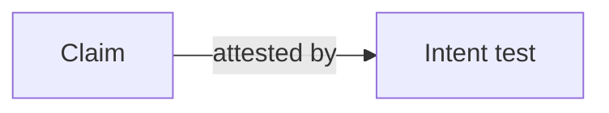

## Navigation

- **Parent**: [Contributing to CSD Docs](./00-OVERVIEW.md)

---

## 1. Overview

This standard defines the rules for authoring pages on the CSD documentation site. New doc pages MUST use the [Document Template](./04-DOCUMENT-TEMPLATE.md). Methodology artifacts (intent specs, test specs) use templates from the [Templates](../05-TEMPLATES/00-OVERVIEW.md) section.

---

## 2. Core Requirements

### 2.1 Use Templates

Every new document MUST be created from a template:

- Doc pages (Overview, Standard, Guide, Reference) -> the matching section of the [Document Template](./04-DOCUMENT-TEMPLATE.md)
- Methodology artifacts (intent specs, intent tests) -> the [Templates](../05-TEMPLATES/00-OVERVIEW.md) section

### 2.2 Frontmatter Metadata

Every document MUST begin with:

1. YAML frontmatter with all mandatory fields
2. A `title` field in frontmatter used as the canonical page title

See [Metadata Standard](./02-METADATA-STANDARD.md) for required fields.

### 2.3 Numbered Sections

All major sections MUST be numbered:

- Level 1: `1.`, `2.`, `3.`
- Level 2: `1.1`, `1.2`, `2.1`
- Level 3: `1.1.1`, `1.1.2` (use sparingly)

### 2.4 Navigation Section

Documents MUST include a navigation section after the frontmatter block showing:

- **Parent**: Link to parent document
- **Children**: Links to child documents (if any)

---

## 3. Document Types

| Type | Purpose | Template Source |
|------|---------|-----------------|
| **Overview** | Entry point for a section | [Document Template](./04-DOCUMENT-TEMPLATE.md), Overview section |
| **Standard** | Rules and requirements | [Document Template](./04-DOCUMENT-TEMPLATE.md), Standard section |
| **Guide** | How-to documentation | [Document Template](./04-DOCUMENT-TEMPLATE.md), Guide section |
| **Reference** | Lookup information | [Document Template](./04-DOCUMENT-TEMPLATE.md), Reference section |
| **Intent** | Intent definition page | [Intent Spec Template](../05-TEMPLATES/01-INTENT-SPEC-TEMPLATE.md) |

---

## 4. Content Guidelines

### 4.1 Code Blocks

Always specify the language:

````markdown
```yaml
intent_id: INT-001
statement: "Session must be isolated"
```
````

Supported languages: `yaml`, `typescript`, `python`, `json`, `bash`, `text`, `mermaid`

### 4.2 Tables

Use tables for:

- Configuration
- Comparisons
- Reference data

### 4.3 Diagrams

Diagrams are code-rendered Mermaid, never ASCII art or images. Diagrams carry a page's structure; prose annotates them:

````markdown

````

Pages with `type: Flow` carry their sequence as a Mermaid `sequenceDiagram`, which is what the page-structure intent tests check for. Every `mermaid` block is structurally validated by the doc test suite.

### 4.4 Links

Internal links MUST be relative:

````markdown
# Same folder
[Document](./other-doc.md)

# Parent folder  
[Parent](../00-OVERVIEW.md)

# Child folder
[Child](./subfolder/doc.md)
```
````

---

## 5. Machine-Parsability Requirements

CSD documentation must be consumable by AI tools. This requires:

### 5.1 Consistent Structure

- Every document follows its type template exactly
- Sections appear in the same order
- Metadata fields are consistent

### 5.2 Explicit Over Implicit

Wrong: "Tests should probably run quickly"

Right: "Tests at unit scope MUST complete in < 100ms"

### 5.3 Quantifiable Where Possible

- Use specific numbers, not vague terms
- Define "fast", "small", "critical" explicitly
- Include thresholds and limits

---

## 6. Quality Checklist

Before submitting documentation:

- [ ] Uses appropriate template
- [ ] Has complete frontmatter metadata
- [ ] Sections are numbered
- [ ] Code blocks have language specified
- [ ] Internal links are relative
- [ ] Language is explicit, not vague
- [ ] Diagrams render correctly

---

## Change Log

| Version | Date | Author | Changes |
|---------|------|--------|---------|
| 1.1.0 | 2026-07-04 | CSD Team | Mermaid as the diagram standard, validated by the doc tests |
| 1.0.0 | 2026-07-04 | CSD Team | Template references point at real files; diagram rules match the structure tests; promoted to Active |
| 0.1.0 | 2026-02-04 | CSD Team | Initial documentation standard |
