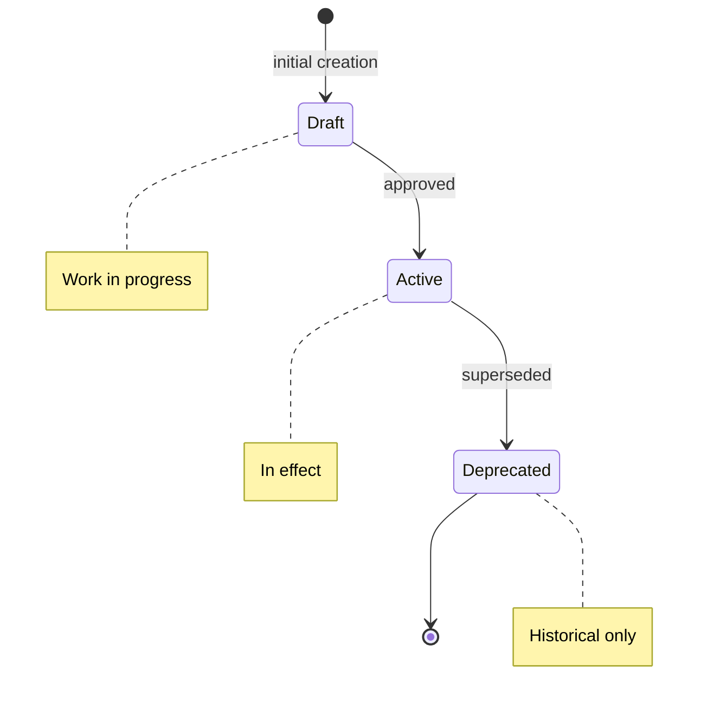

## Navigation

- **Parent**: [Contributing to CSD Docs](./00-OVERVIEW.md)

---

## 1. Overview

This standard defines the mandatory frontmatter fields for all pages on the CSD documentation site. Consistent metadata enables automated tooling, validation, and discovery.

---

## 2. Mandatory Fields

All documents MUST include these frontmatter fields:

| Field | Description | Format |
|-------|-------------|--------|
| `title` | Canonical page title | String |
| `id` | Unique identifier | `PREFIX-NN` or `PREFIX-CATEGORY-NN` |
| `type` | Document type | One of: Overview, Standard, Guide, Template, Reference, Intent |
| `status` | Current status | One of: Draft, Active, Deprecated |
| `version` | Semantic version | `MAJOR.MINOR.PATCH` |
| `updated` | Last modified date | `YYYY-MM-DD` |

---

## 3. Optional Fields

| Field | Description | When Required |
|-------|-------------|---------------|
| `owner` | Responsible team/person | For Standards and Intent specs |
| `features` | Related feature IDs | For service/component docs |
| `parent` | Parent intent ID | For child intents |
| `criticality` | Business criticality | For intent specs when needed |

---

## 4. ID Conventions

### 4.1 Document IDs

| Type | Pattern | Example |
|------|---------|---------|
| Root overview | `CSD-OVERVIEW` | `CSD-OVERVIEW` |
| Section overview | `CSD-{SECTION}-OVERVIEW` | `CSD-INTENT-OVERVIEW` |
| Numbered section page | `CSD-{SECTION}-NN` | `CSD-INTENT-01`, `CSD-TEST-03` |
| Intent spec page | Claim ID | `INT-001`, `INT-CSD-002` |

### 4.2 Intent IDs

Intent IDs MUST:

- Start with `INT-`
- Use 3-digit zero-padded numbers (`INT-001`), or an uppercase module prefix plus number in a monorepo (`INT-CSD-001`)
- Be globally unique within the project
- NEVER be reused (even if deprecated)

See the [Intent Specification Standard](../01-INTENT/01-SPECIFICATION.md) for the normative ID rules.

---

## 5. Status Lifecycle



| Status | Meaning |
|--------|---------|
| **Draft** | Work in progress, not yet reviewed |
| **Active** | Approved and in effect |
| **Deprecated** | No longer valid, kept for history |

---

## 6. Version Numbering

Use Semantic Versioning:

| Change Type | Version Bump | Example |
|-------------|--------------|---------|
| Breaking changes | MAJOR | `1.0.0` -> `2.0.0` |
| New content, backward compatible | MINOR | `1.0.0` -> `1.1.0` |
| Typo fixes, clarifications | PATCH | `1.0.0` -> `1.0.1` |

For Intent Specs:

- Changing the statement = MAJOR
- Adding test scope = MINOR
- Clarifying examples = PATCH

---

## 7. Validation

Metadata validation MUST be automated:

```yaml
# Example validation schema
document:
  required:
    - title
    - id
    - type
    - status
    - version
    - updated
  types:
    title: string
    id: string
    type: enum[Overview, Standard, Guide, Template, Reference, Intent]
    status: enum[Draft, Active, Deprecated]
    version: semver
    updated: date
```

---

## Change Log

| Version | Date | Author | Changes |
|---------|------|--------|---------|
| 1.1.0 | 2026-07-04 | CSD Team | Status lifecycle in Mermaid |
| 1.0.0 | 2026-07-04 | CSD Team | ID conventions match the IDs in use; intent ID rules cite the normative standard; promoted to Active |
| 0.1.0 | 2026-02-04 | CSD Team | Initial metadata standard |
